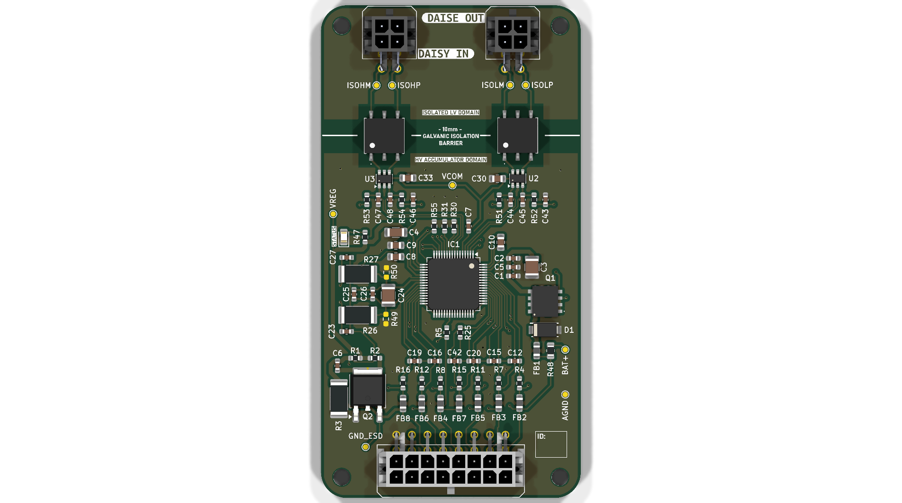
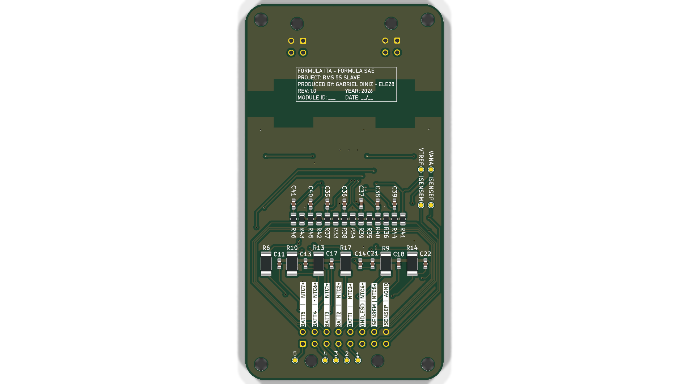
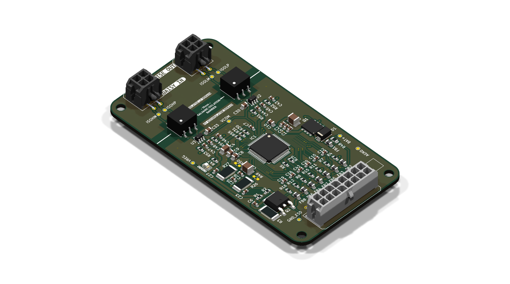
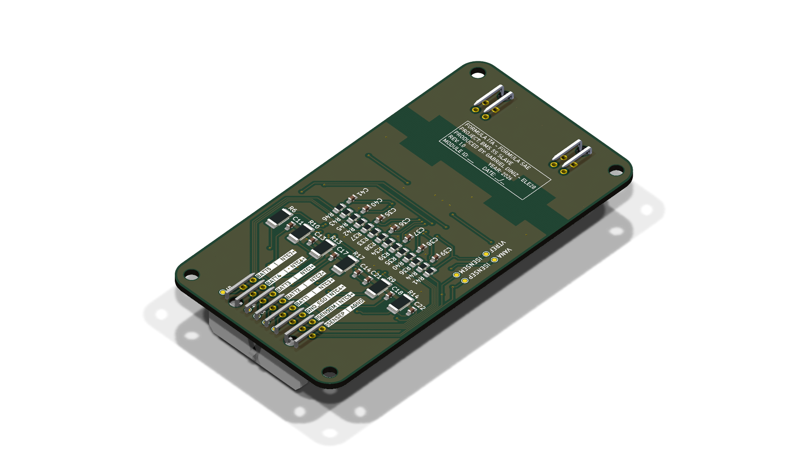
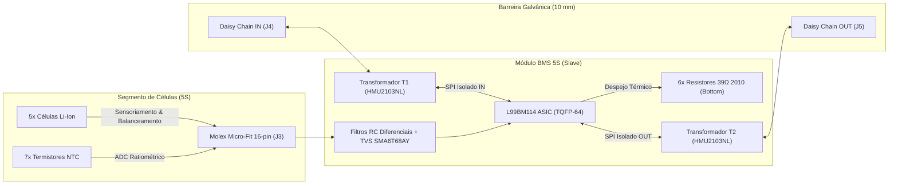

# BMS-5S-L9963E-TR — Formula ITA (Formula SAE EV)


Módulo escravo descentralizado de monitoramento, sensoriamento e balanceamento passivo de acumulador elétrico de alta tensão, projetado para o protótipo de Fórmula SAE Elétrico da **Formula ITA**. O subsistema gerencia blocos de até 5 células Li-Ion/LiFePO4 em série, baseado no ASIC automotivo dedicado **STMicroelectronics L99BM114**.

---

## 📸 Renderizações 3D do Projeto

| Vista Superior (Top View) | Vista Inferior (Bottom View) |
| :---: | :---: |
|  |  |

| Perspectiva Superior Isométrica | Perspectiva Inferior Isométrica |
| :---: | :---: |
|  |  |

---

## 1. Visão Geral da Arquitetura

O sistema adota arquitetura distribuída/modular de BMS para baterias de tração (HV). Os módulos escravos operam conectados ao segmento local de células e comunicam-se com a ECU Central através de um barramento serial em topologia **Daisy-Chain isolada por transformadores de pulso**.



---

## 2. Especificações Técnicas

| Parâmetro | Especificação de Projeto | Norma / Referência |
| :--- | :--- | :--- |
| **Topologia de Baterias** | 2S a 5S Li-Ion, LiPo ou LiFePO4 | ST L99BM114 Specs |
| **Faixa de Tensão por Célula** | $0.5\text{ V}$ a $4.5\text{ V}$ (ADC de 16 bits, erro $\le \pm 1.5\text{ mV}$) | AEC-Q100 Grau 1 |
| **Balanceamento** | Passivo individual, $I_{bal} \approx 105\text{ mA}$ ($R_{bal} = 39\,\Omega$ / $0.75\text{ W}$) | Dissipação no Bottom Layer |
| **Monitoramento Térmico** | 7 canais independentes para NTCs $10\text{ k}\Omega$ | FSAE EV4.4 (1 sensor / 2 células) |
| **Isolação Galvânica** | **10.00 mm de Clearance e Creepage contínuos** | FSAE EV4.5 ($> 4.0\text{ mm}$ exigido) |
| **Tensão de Isolamento** | $> 2500\text{ V RMS}$ (Pulse HMU2103NL AEC-Q200) | Isolamento Reforçado |
| **Dimensões Mecânicas** | $50.00\text{ mm} \times 95.00\text{ mm}$ | Placa 4 camadas, 1.6 mm |
| **Fixação Mecânica** | 4 furos M3 NPTH nos cantos (sem anel de cobre) | Isolamento com chassi do carro |

---

## 3. Pinout & Conexões

### Conector de Bateria e Temperatura (`J3` — Molex Micro-Fit 3.0 16 pinos)
*Conector principal de interface com o rack de células.*

```text
┌────────────────────────────────────────────────────────┐
│  J3 - CELL SENSING & NTC CONNECTOR PINOUT              │
│  [Pin 01]  C0 (BATT -)              [Pin 09]  NTC7 +   │
│  [Pin 02]  C1                       [Pin 10]  NTC6 +   │
│  [Pin 03]  C2                       [Pin 11]  NTC1 +   │
│  [Pin 04]  C3                       [Pin 12]  NTC2 +   │
│  [Pin 05]  C4                       [Pin 13]  NTC3 +   │
│  [Pin 06]  C5 (BATT +)              [Pin 14]  NTC4 +   │
│  [Pin 07]  ISENSE P                 [Pin 15]  NTC5 +   │
│  [Pin 08]  ISENSE M                 [Pin 16]  AGND     │
└────────────────────────────────────────────────────────┘
```

### Portas de Comunicação Isolada (`J4` e `J5` — Molex Micro-Fit 3.0 4 pinos)
- **`J4` (Daisy Chain IN):** Entrada diferencial do sinal da ECU mestre ou do escravo anterior.
- **`J5` (Daisy Chain OUT):** Saída diferencial para encaminhamento ao próximo módulo escravo.

---

## 4. Elementos de Serigrafia (Paddock-Proofing)

A placa inclui sinalizações para evitar erros de conexão na montagem e no box:
- **Barreira de 10 mm:** Linha divisória e texto `⚡ 10mm GALVANIC ISOLATION BARRIER ⚡` separando o domínio de alta tensão (`HV ACCUMULATOR DOMAIN`) do domínio de baixa tensão (`ISOLATED LV DOMAIN`).
- **Mapeamento no Silkscreen:** Legenda dos pinos de células e NTCs diretamente no verso do conector `J3`.
- **Rastreabilidade e QA:** Caixa de anotação de identificação de módulo (`MODULE ID: ___`), data e aprovação em controle de qualidade.
- **LED de Status:** Legenda `STATUS` junto ao LED `D4` para depuração rápida.

---

## 5. Arquivos de Fabricação

Os arquivos prontos para manufatura encontram-se no diretório `BMS_5S_v2/fabrication/`:
- **`BMS_5S_L99BM114_Gerber_Drill.zip`:** Pacote consolidado contendo os Gerbers (RS-274X), furação Excellon (`PTH` e `NPTH`) e mapa de furos em PDF para upload direto na JLCPCB ou PCBWay.
- **`BMS_5S_L99BM114.d356`:** Netlist IPC-D-356 para teste elétrico de agulhas móveis (*Flying Probe Test*).
- **`cpl/BMS_5S_L99BM114_cpl.csv`:** Arquivo de centróides / Pick-and-Place para a montadora SMT.
- **`bom/BMS_5S_L99BM114_bom.csv`:** Lista de materiais agrupada com footprints e part numbers.
- **`BMS_5S_L99BM114_Schematic.pdf`:** Esquemático completo em PDF vetorial.

---

## 6. Como Abrir e Validar o Projeto

### Pré-requisitos
- KiCad EDA versão 10.0 ou superior.

### Verificação de Regras de Projeto (DRC)
Abra o projeto pelo KiCad ou execute pelo terminal:
```bash
kicad-cli pcb drc --output drc_report.json --format json --severity-all BMS_5S_v2/BMS_5S_v2.kicad_pcb
```

### Regenerar Pacote de Fabricação
```bash
kicad-cli pcb export gerbers -o BMS_5S_v2/fabrication/gerber/ --no-x2 --subtract-soldermask --check-zones BMS_5S_v2/BMS_5S_v2.kicad_pcb
kicad-cli pcb export drill -o BMS_5S_v2/fabrication/gerber/ --format excellon --excellon-units mm --excellon-separate-th BMS_5S_v2/BMS_5S_v2.kicad_pcb
```

---

## 7. Licença & Créditos

Projeto desenvolvido por **Gabriel Diniz (ELE28)** para a equipe **Formula ITA**.
Distribuído sob a licença **CERN-OHL-S v2** (CERN Open Hardware Licence Strongly Reciprocal). Consulte o arquivo `LICENSE` para mais detalhes.
