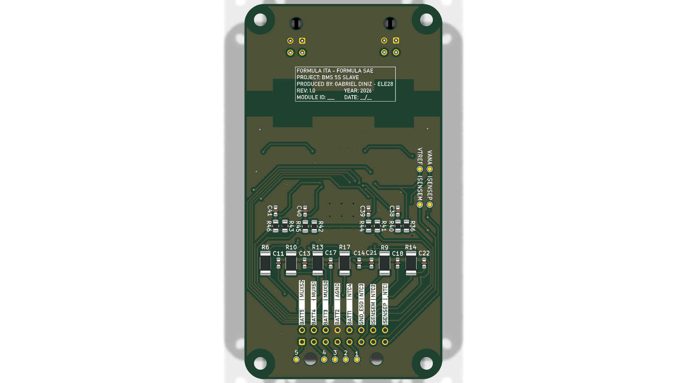
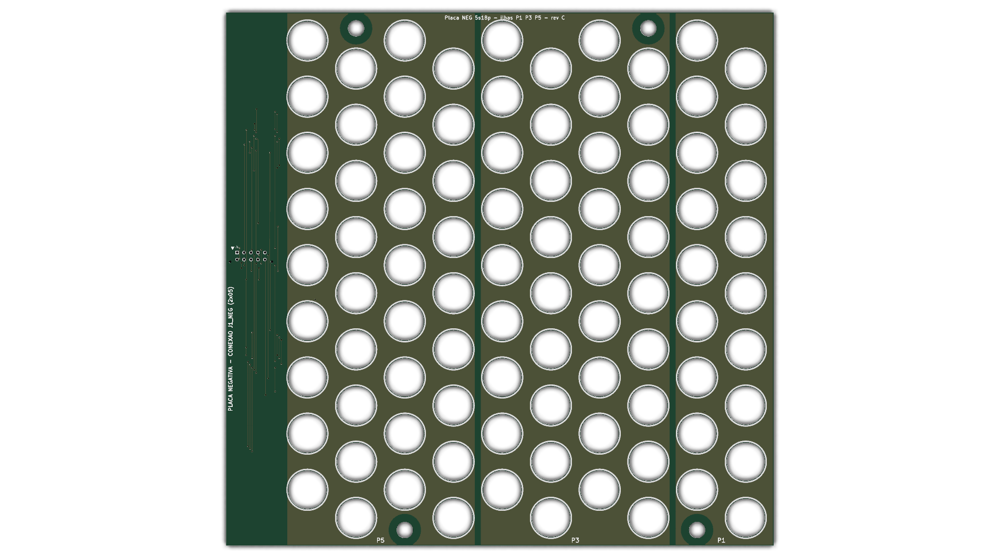
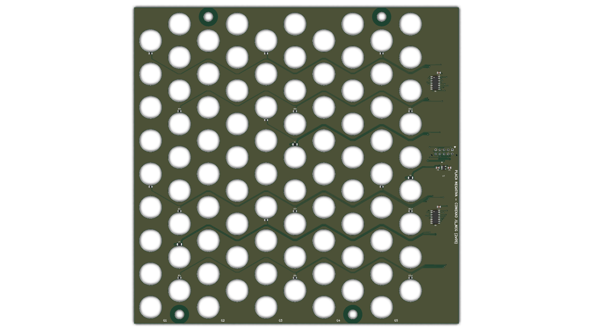
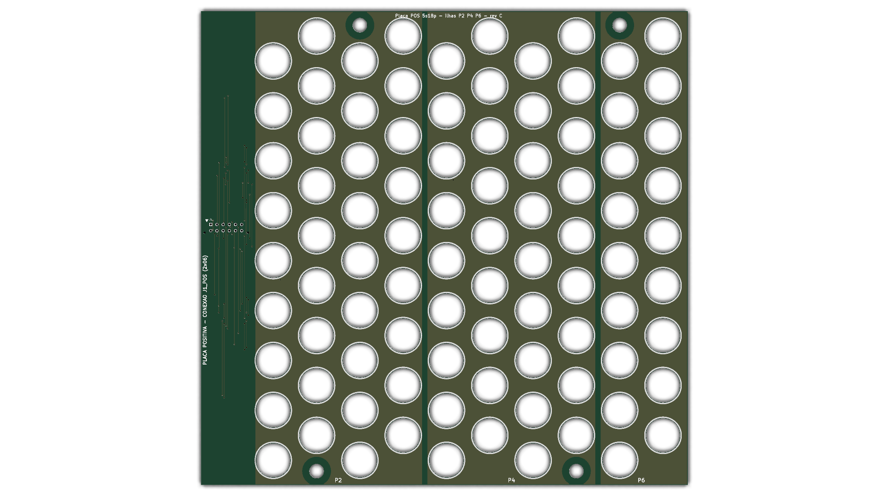
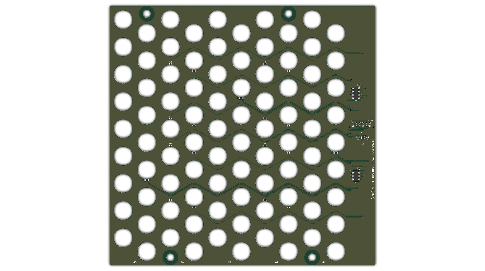

# BMS 5S (L99BM114) & Placas de Sensoriamento do Chicote (5s18p) — Formula ITA
### Módulo Escravo Distribuído de Sensoriamento de Células, Balanceamento e Termistores NTC (Formula SAE EV)

Repositório oficial e unificado (**Monorepo**) de **Hardware**, **Placas de Sensoriamento do Chicote** e **Documentação Técnica** dos módulos escravos (Slaves) do Battery Management System (BMS) da equipe **Formula ITA** (Temporada 2025-2026).

---

## Renderizações 3D dos Hardwares

### Módulo BMS 5S Slave (L99BM114)

Placa de 4 camadas dedicada ao monitoramento de cada bloco 5S, dotada de barreira galvânica de isolação automotiva, balanceamento passivo e filtros diferenciais de alta precisão.

<div align="center">
  
  <p><em>Vista Isométrica Superior — Destaque para o ASIC ST L99BM114, transformadores de pulso Pulse HMU2103NL (Isolated SPI Daisy-Chain), filtros de entrada e conectores Molex Micro-Fit 3.0.</em></p>
</div>

<br>

| Perspectiva Superior (Iso Top) | Perspectiva Inferior (Iso Bottom) |
| :---: | :---: |
|  |  |
| **Vista Ortográfica Superior (Top View)** | **Vista Ortográfica Inferior (Bottom View)** |
|  |  |

---

### Placas de Sensoriamento e Chicote do Módulo (5s18p — Rev C)

Placas de barramento posicionadas diretamente nos terminais das células 21700 de cada segmento, integrando 32 termistores NTC 10k, multiplexadores analógicos de 5V e fusíveis de sense ultrarrápidos contra curto-circuito.

| Placa NEG (Ilhas P1, P3, P5) — Face Superior | Placa NEG — Plano AGND (Bottom) |
| :---: | :---: |
|  |  |
| **Placa POS (Ilhas P2, P4, P6) — Face Superior** | **Placa POS — Plano AGND (Bottom)** |
|  |  |

---

## Destaques de Arquitetura e Engenharia

1. **Topologia do Acumulador:**
   * O acumulador total de tração é composto por **8 módulos 5s18p** em série (**40S18P = 720 células** formato 21700, 168V nominais).
   * Cada módulo possui:
     * **1x Placa BMS 5S Slave**
     * **1x Placa Chicote NEG** (conector Molex 2x05 vertical com trava)
     * **1x Placa Chicote POS** (conector Molex 2x06 vertical com trava anti-inversão)
     * **1x Chicote em Y** conectando as duas placas ao conector **J3 (2x08)** do Slave.
2. **ASIC Automotivo de Alta Resolução (ST L99BM114):**
   * Medição síncrona de tensão de células com ADC de 16 bits ($\pm 1{,}5\text{ mV}$).
   * Balanceamento passivo programável por PWM individual com resistores de potência no layer inferior.
3. **Sensoriamento Térmico Abrangente (FSAE EV4.4):**
   * 32 termistores NTC 10k 1% (16 por placa) mapeados por módulo, garantindo amostragem térmica direta de mais de 40% das células do pack.
   * Multiplexação local por CIs `74HC4051D` alimentados a 5.0V pelo LDO ultrabaixo consumo `TI TPS70950DBVR` ($I_Q \approx 1\,\mu\text{A}$, eliminando descarga parasita do pack em repouso).
4. **Proteção Intrínseca contra Falha:**
   * Linhas de medição de tensão protegidas por fusíveis cerâmicos ultrarrápidos `Littelfuse 0466.125NRHF` (125 mA / 125 V, 50 A capacidade de interrupção).
   * Diodos TVS `SMA6T68AY` e filtros RC passa-baixas diferenciais em todas as entradas de sensoriamento.
5. **Comunicação Segura em Daisy-Chain (FSAE EV4.8 / IEC 60664):**
   * Barramento Iso-SPI diferencial serial acoplado via transformadores `Pulse HMU2103NL` ($\ge 2500\text{ V}_{RMS}$, creepage $\ge 4{,}0\text{ mm}$ e folga no layout $\ge 6{,}5\text{ mm}$).

---

## Mapeamento de Pinos & Interconexão

### Pinagem do Chicote em Y: Placas NEG/POS $\to$ Conector J3 do BMS Slave

| Pino J3 (BMS) | Sinal | Origem no Módulo | Função / Descrição |
|:---:|:---:|:---:|:---|
| **1** | `BATT14` | POS J1.11 | Tensão Célula 5 (Topo do módulo, até 21.0V) |
| **2** | `BATT13` | NEG J1.9 | Tensão Célula 4 (Até 16.8V) |
| **3** | `BATT12` | POS J1.9 | Tensão Célula 3 (Até 12.6V) |
| **4** | `BATT2`  | NEG J1.8 | Tensão Célula 2 (Até 8.4V) |
| **5** | `BATT1`  | POS J1.10| Tensão Célula 1 (Até 4.2V) |
| **6** | `GND_ESD`| NEG J1.10| Retorno / Negativo do Módulo (0V local) |
| **7** | *NC*     | — | Reserva / Sem conexão |
| **8** | *NC*     | — | Reserva / Sem conexão |
| **9** | `MUX_S2` | Y: NEG J1.4 + POS J1.4 | Bit 2 de seleção de canal dos multiplexadores |
| **10**| `MUX_S1` | Y: NEG J1.3 + POS J1.3 | Bit 1 de seleção de canal dos multiplexadores |
| **11**| `MUX_S0` | Y: NEG J1.2 + POS J1.2 | Bit 0 de seleção de canal dos multiplexadores |
| **12**| `AGND`   | Y: NEG J1.5 + POS J1.5 | Referência analógica de sensoriamento NTC |
| **13**| `NTC_CH4`| POS J1.8 | Saída multiplexada MUX B da placa POS (NTCs 9 a 16) |
| **14**| `NTC_CH3`| POS J1.7 | Saída multiplexada MUX A da placa POS (NTCs 1 a 8) |
| **15**| `NTC_CH2`| NEG J1.7 | Saída multiplexada MUX B da placa NEG (NTCs 9 a 16) |
| **16**| `NTC_CH1`| NEG J1.6 | Saída multiplexada MUX A da placa NEG (NTCs 1 a 8) |

> **Chaveamento Anti-Inversão:** O conector J1 da Placa NEG é Molex Micro-Fit 2x05 (`43045-1012`), enquanto o J1 da Placa POS é 2x06 (`43045-1212`). Essa diferença mecânica impede fisicamente a conexão invertida dos plugs durante a montagem no acumulador.

---

## Estrutura do Repositório (Monorepo)

```text
BMS 5S - STM - V2/
├── .gitignore                         # Regras de exclusão Git (KiCad, builds, temporários)
├── README.md                          # Visão geral, especificações e documentação rápida
├── LICENSE                            # Licença de Hardware Aberto (CERN-OHL-S v2)
├── CONTRIBUTING.md                     # Diretrizes de contribuição e engenharia
│
├── docs/                              # Documentação técnica e manuais
│   ├── schematics/                    # Esquemáticos oficiais em PDF vetorial
│   │   ├── BMS_5S_Slave_Schematic.pdf       # Esquemático hierárquico do BMS Slave V2 (KiCad 10)
│   │   ├── Placa_Chicote_NEG_Schematic.pdf  # Esquemático da placa de sensoriamento NEG (5s18p)
│   │   └── Placa_Chicote_POS_Schematic.pdf  # Esquemático da placa de sensoriamento POS (5s18p)
│   ├── datasheets/                    # Folhas de dados de componentes críticos (L99BM114)
│   └── MANUAL_OPERACIONAL_E_MONTAGEM_BMS.md # Manual de montagem, chicotes e testes
│
├── hardware/                          # Projetos de Hardware no KiCad 10
│   ├── bms_5s_slave/                  # Projeto KiCad do Módulo BMS 5S Slave
│   │   ├── BMS_5S_v2.kicad_pro        # Projeto mestre KiCad
│   │   ├── BMS_5S_v2.kicad_sch        # Esquemático mestre
│   │   ├── BMS_5S_v2.kicad_pcb        # Layout de 4 camadas (Top/In1/In2/Bot)
│   │   ├── Cell_Sensing.kicad_sch     # Folha: Sensoriamento e balanceamento de células
│   │   ├── Current_Sensing.kicad_sch  # Folha: Entradas de derivação Kelvin para corrente
│   │   ├── Isolated_Communication.kicad_sch # Folha: Barreira Iso-SPI e transformadores
│   │   ├── NTC_and_GPIO.kicad_sch     # Folha: Condicionamento de termistores e GPIOs
│   │   ├── Power_Management.kicad_sch # Folha: Aterramento inteligente e alimentação
│   │   ├── Support_and_Debug.kicad_sch# Folha: Pontos de teste e LEDs de status
│   │   ├── fp-lib-table, sym-lib-table# Mapeamento local de bibliotecas
│   │   ├── libraries/                 # Símbolos locais e footprints dos componentes dedicados
│   │   ├── 3dmodels/                  # Modelos 3D STEP/WRL dos conectores e CIs
│   │   └── fabrication/               # Pacote de manufatura e montagem SMT
│   │       ├── gerbers/               # Arquivos Gerber RS-274X, Drills Excellon e ZIP final
│   │       ├── bom/                   # Listas de materiais (BOM CSV, Mouser, Interactive BOM)
│   │       └── cpl/                   # Arquivo de coordenadas Pick & Place (pos.csv)
│   │
│   └── chicote_5s18p/                 # Placas de sensoriamento do módulo 5s18p e chicote
│       ├── CHICOTE_BMS.md             # Especificação e montagem do chicote em Y
│       ├── PINAGEM_e_NTCs.md          # Mapa detalhado de pinagem e posições dos 32 NTCs
│       ├── LEIA.md                    # Histórico de revisões e notas de auditoria Rev C
│       ├── placa_neg/                 # Projeto KiCad da Placa NEG (ilhas P1, P3, P5)
│       │   ├── Placa_NEG_5s18p.kicad_pro
│       │   ├── Placa_NEG_5s18p.kicad_sch
│       │   ├── Placa_NEG_5s18p.kicad_pcb
│       │   ├── fp-lib-table
│       │   └── FormulaITA.pretty/     # Footprints de anel de contato das células 21700
│       └── placa_pos/                 # Projeto KiCad da Placa POS (ilhas P2, P4, P6)
│           ├── Placa_POS_5s18p.kicad_pro
│           ├── Placa_POS_5s18p.kicad_sch
│           ├── Placa_POS_5s18p.kicad_pcb
│           ├── fp-lib-table
│           └── FormulaITA.pretty/     # Footprints de anel de contato das células 21700
│
└── renders/                           # Renderizações fotorrealistas em alta resolução (KiCad 10)
    ├── slave_render_iso_top.png
    ├── slave_render_iso_bottom.png
    ├── slave_render_top.png
    ├── slave_render_bottom.png
    ├── chicote_neg_render_top.png
    ├── chicote_neg_render_bottom.png
    ├── chicote_pos_render_top.png
    └── chicote_pos_render_bottom.png
```

---

## Como Abrir e Visualizar os Projetos no KiCad 10

1. **BMS 5S Slave:**
   - Abra o **KiCad 10** e aponte para:  
     `hardware/bms_5s_slave/BMS_5S_v2.kicad_pro`.
   - Abra o PCB Editor e pressione <kbd>Alt</kbd> + <kbd>3</kbd> para abrir o visualizador 3D com raytracing.
2. **Placas de Sensoriamento do Chicote (5s18p):**
   - Placa NEG: abra `hardware/chicote_5s18p/placa_neg/Placa_NEG_5s18p.kicad_pro`.
   - Placa POS: abra `hardware/chicote_5s18p/placa_pos/Placa_POS_5s18p.kicad_pro`.
3. **Esquemáticos Rápidos em PDF:**
   - Consulte diretamente a pasta [`docs/schematics/`](docs/schematics/) sem necessidade de abrir a ferramenta de CAD.

---

<div align="center">
  <sub>Formula ITA — Equipe de Formula SAE Elétrico do Instituto Tecnológico de Aeronáutica (ITA).</sub>
</div>
