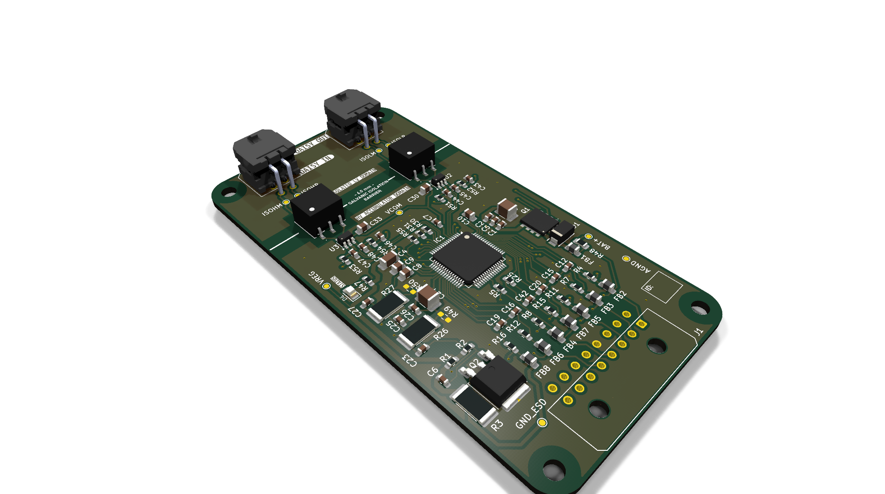
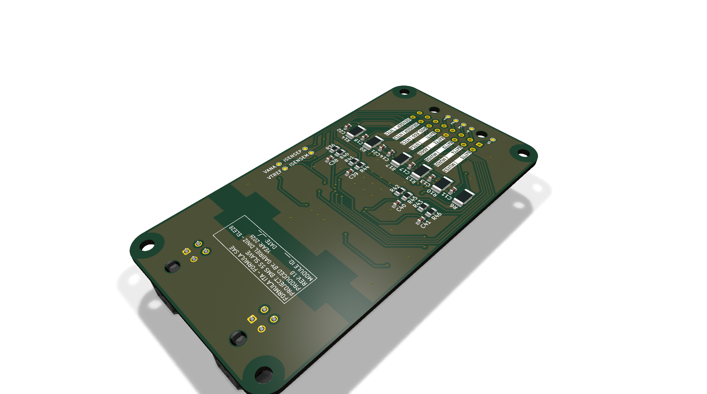
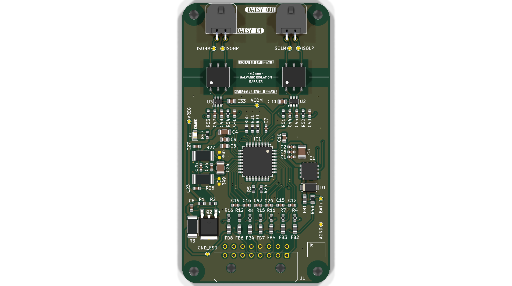

# BMS 5S (L99BM114) — Formula ITA
### Módulo Escravo Distribuído de Sensoriamento de Células, Balanceamento e Termistores NTC (Formula SAE EV)

Repositório oficial de **Hardware** e **Documentação Técnica** do módulo escravo (Slave) do Battery Management System (BMS) da equipe **Formula ITA** (Temporada 2025-2026).

---

## Renderizações 3D do Hardware

### Módulo BMS 5S Slave (L99BM114)

Placa de 4 camadas dedicada ao monitoramento de cada bloco 5S, dotada de barreira galvânica de isolação automotiva, balanceamento passivo e filtros diferenciais de alta precisão.

<div align="center">
  
  <p><em>Vista Isométrica Superior — Destaque para o ASIC ST L99BM114, transformadores de pulso Pulse HMU2103NL (Isolated SPI Daisy-Chain), filtros de entrada e conectores Molex Micro-Fit 3.0.</em></p>
</div>

<br>

| Perspectiva Superior (Iso Top) | Perspectiva Inferior (Iso Bottom) |
| :---: | :---: |
|  |  |
| **Vista Ortográfica Superior (Top View)** | **Vista Ortográfica Inferior (Bottom View)** |
|  |  |

---

## Destaques de Arquitetura e Engenharia

1. **Topologia do Sistema no Acumulador:**
   * O acumulador total de tração é composto por **8 módulos 5s18p** em série (**40S18P = 720 células** formato 21700, 168V nominais).
   * Cada módulo possui **1x Placa BMS 5S Slave**, comunicando-se em cadeia (daisy-chain) com o BMS Master.
2. **ASIC Automotivo de Alta Resolução (ST L99BM114):**
   * Medição síncrona de tensão de células com ADC de 16 bits ($\pm 1{,}5\text{ mV}$).
   * Balanceamento passivo programável por PWM individual com resistores de potência no layer inferior.
3. **Sensoriamento Térmico Abrangente (FSAE EV4.4):**
   * Interface multiplexada para leitura de termistores NTC 10k 1% por módulo, atendendo aos requisitos de amostragem térmica de células do regulamento FSAE.
4. **Proteção Intrínseca contra Falha:**
   * Linhas de medição de tensão protegidas por fusíveis cerâmicos ultrarrápidos `Littelfuse 0466.125NRHF` (125 mA / 125 V, 50 A capacidade de interrupção).
   * Diodos TVS `SMA6T68AY` e filtros RC passa-baixas diferenciais em todas as entradas de sensoriamento.
5. **Comunicação Segura em Daisy-Chain (FSAE EV4.8 / IEC 60664):**
   * Barramento Iso-SPI diferencial serial acoplado via transformadores `Pulse HMU2103NL` ($\ge 2500\text{ V}_{RMS}$, creepage $\ge 4{,}0\text{ mm}$ e folga no layout $\ge 6{,}5\text{ mm}$).

---

## Mapeamento de Pinos do Conector de Sensoriamento (J3)

O conector **J3** (Molex Micro-Fit 3.0 de 16 vias — `43045-1600`) é a interface primária do BMS Slave para leitura das tensões de célula e das linhas multiplexadas de temperatura:

| Pino J3 | Sinal | Descrição Técnica |
|:---:|:---:|:---|
| **1** | `BATT14` | Tensão Célula 5 (Topo do módulo, até 21.0V) |
| **2** | `BATT13` | Tensão Célula 4 (Até 16.8V) |
| **3** | `BATT12` | Tensão Célula 3 (Até 12.6V) |
| **4** | `BATT2`  | Tensão Célula 2 (Até 8.4V) |
| **5** | `BATT1`  | Tensão Célula 1 (Até 4.2V) |
| **6** | `GND_ESD`| Retorno / Referência Negativa do Módulo (0V local) |
| **7** | *NC*     | Não conectado |
| **8** | *NC*     | Não conectado |
| **9** | `MUX_S2` | Linha de controle digital: Bit 2 dos multiplexadores de NTC |
| **10**| `MUX_S1` | Linha de controle digital: Bit 1 dos multiplexadores de NTC |
| **11**| `MUX_S0` | Linha de controle digital: Bit 0 dos multiplexadores de NTC |
| **12**| `AGND`   | Referência analógica de sensoriamento NTC |
| **13**| `NTC_CH4`| Canal analógico multiplexado 4 (NTCs 25 a 32) |
| **14**| `NTC_CH3`| Canal analógico multiplexado 3 (NTCs 17 a 24) |
| **15**| `NTC_CH2`| Canal analógico multiplexado 2 (NTCs 9 a 16) |
| **16**| `NTC_CH1`| Canal analógico multiplexado 1 (NTCs 1 a 8) |

---

## Estrutura do Repositório

```text
BMS 5S - STM - V2/
├── .gitignore                         # Regras de exclusão Git (KiCad, builds, temporários)
├── README.md                          # Visão geral, especificações e documentação rápida
├── LICENSE                            # Licença de Hardware Aberto (CERN-OHL-S v2)
├── CONTRIBUTING.md                     # Diretrizes de contribuição e engenharia
│
├── docs/                              # Documentação técnica e manuais
│   ├── schematics/                    # Esquemáticos oficiais em PDF vetorial
│   │   └── BMS_5S_Slave_Schematic.pdf # Esquemático hierárquico do BMS Slave V2 (KiCad 10)
│   ├── datasheets/                    # Folhas de dados de componentes críticos (L99BM114)
│   └── MANUAL_OPERACIONAL_E_MONTAGEM_BMS.md # Manual de montagem e testes
│
├── hardware/                          # Projetos de Hardware no KiCad 10
│   └── bms_5s_slave/                  # Projeto KiCad do Módulo BMS 5S Slave
│       ├── BMS_5S_v2.kicad_pro        # Projeto mestre KiCad
│       ├── BMS_5S_v2.kicad_sch        # Esquemático mestre
│       ├── BMS_5S_v2.kicad_pcb        # Layout de 4 camadas (Top/In1/In2/Bot)
│       ├── Cell_Sensing.kicad_sch     # Folha: Sensoriamento e balanceamento de células
│       ├── Current_Sensing.kicad_sch  # Folha: Entradas de derivação Kelvin para corrente
│       ├── Isolated_Communication.kicad_sch # Folha: Barreira Iso-SPI e transformadores
│       ├── NTC_and_GPIO.kicad_sch     # Folha: Condicionamento de termistores e GPIOs
│       ├── Power_Management.kicad_sch # Folha: Aterramento inteligente e alimentação
│       ├── Support_and_Debug.kicad_sch# Folha: Pontos de teste e LEDs de status
│       ├── fp-lib-table, sym-lib-table# Mapeamento local de bibliotecas
│       ├── libraries/                 # Símbolos locais e footprints dos componentes dedicados
│       ├── 3dmodels/                  # Modelos 3D STEP/WRL dos conectores e CIs
│       └── fabrication/               # Pacote de manufatura e montagem SMT
│           ├── gerbers/               # Arquivos Gerber RS-274X, Drills Excellon e ZIP final
│           ├── bom/                   # Listas de materiais (BOM CSV, Mouser, Interactive BOM)
│           └── cpl/                   # Arquivo de coordenadas Pick & Place (pos.csv)
│
└── renders/                           # Renderizações fotorrealistas em alta resolução (KiCad 10)
    ├── slave_render_iso_top.png
    ├── slave_render_iso_bottom.png
    ├── slave_render_top.png
    └── slave_render_bottom.png
```

---

## Como Abrir e Visualizar o Projeto no KiCad 10

1. **BMS 5S Slave:**
   - Abra o **KiCad 10** e carregue o arquivo de projeto:  
     `hardware/bms_5s_slave/BMS_5S_v2.kicad_pro`.
   - Abra o PCB Editor e pressione <kbd>Alt</kbd> + <kbd>3</kbd> para abrir o visualizador 3D com raytracing.
2. **Esquemático Rápido em PDF:**
   - Consulte diretamente [`docs/schematics/BMS_5S_Slave_Schematic.pdf`](docs/schematics/BMS_5S_Slave_Schematic.pdf) sem necessidade de abrir o KiCad.

---

<div align="center">
  <sub>Formula ITA — Equipe de Formula SAE Elétrico do Instituto Tecnológico de Aeronáutica (ITA).</sub>
</div>
