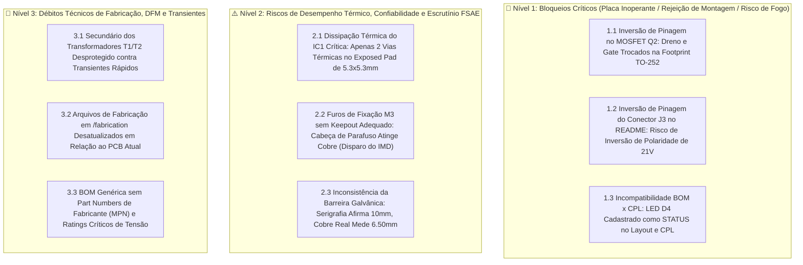

# 🛑 Relatório de Auditoria Final & Problemas Críticos Pré-Manufatura
## Módulo BMS 5S Slave (L99BM114) — Formula ITA
**Documento de Engenharia para Revisão e Sanamento de Hardware**  
**Data:** 22 de Outubro de 2026 | **Versão:** 2.1 — Pré-Fabricação  
**Veredito Técnico:** 🛑 **REPROVADO PARA FABRICAÇÃO IMEDIATA (BLOQUEIOS DETECTADOS)**

---

## 1. Sumário Executivo & Veredito de Escrutínio

Este documento consolida a avaliação técnica final do módulo **BMS 5S V2**, conduzida com o mesmo grau de rigor, tolerância zero e metodologia aplicados no escrutínio técnico da Formula SAE e em revisões de engenharia automotiva (AEC-Q100).

Embora as ferramentas automatizadas de CAD indiquem conformidade de conectividade (0 redes desconectadas e 0 violações de regras elétricas no DRC/ERC), a análise forense das interconexões físicas, pinagens de encapsulamentos, modelos de componentes e arquivos de montagem SMT detectou **erros que impedem o funcionamento da placa na bancada e trazem riscos reais de queima de componentes e reprovação na inspeção veicular**.

> [!CAUTION]
> **Veredito:** O envio dos arquivos de fabricação para a fábrica (**JLCPCB / PCBWay**) deve ser **interrompido** até que os itens de **Nível 1 (Bloqueios Críticos)** sejam sanados e o pacote de fabricação seja completamente regenerado.

---

## 2. Matriz Hierárquica de Problemas Detectados



---

## 3. Detalhamento dos Problemas e Ações Corretivas Necessárias

---

### 🛑 3.1. [BLOQUEIO CRÍTICO] Inversão de Pinagem no MOSFET Q2 (STD105N10F7AG — TO-252)

* **Arquivos Afetados:** `Power_Management.kicad_sch` e `BMS_5S_v2.kicad_pcb`
* **Componente:** `Q2` (MOSFET canal N de proteção contra polaridade reversa e retorno de terra)
* **Diagnóstico Físico:**
  No esquemático hierárquico de gerenciamento de potência, foi utilizado o símbolo `Transistor_FET:Q_NMOS_DGS`, que associa:
  - Pino 1 do símbolo: **Dreno (D)**
  - Pino 2 do símbolo: **Gate (G)**
  - Pino 3 do símbolo: **Source (S)**

  Contudo, o encapsulamento físico **TO-252-2 (DPAK)** adotado no layout possui a seguinte correspondência mecânica padronizada pela JEDEC:
  - **Pad 1 (Terminal Esquerdo Inferior) = GATE (G)**
  - **Pad 2 (Aba Metálica Superior de Dissipação) = DRENO (D)**
  - **Pad 3 (Terminal Direito Inferior) = SOURCE (S)**

  Como o KiCad associa os números dos pinos do símbolo aos números dos pads do footprint, o layout roteou a seguinte malha:
  - **Pad 1 (Fisicamente GATE) $\to$ Soldado à rede `AGND`**
  - **Pad 2 (Fisicamente DRENO / Aba) $\to$ Soldado à rede `Net-(Q2-G)` (Sinal de Gate via R2 de $1\text{ k}\Omega$)**
  - **Pad 3 (Fisicamente SOURCE) $\to$ Soldado à rede `GND_ESD`**

```text
       MAPA REAL NO PCB (ERRADO):                   PINAGEM CORRETA DO TO-252:
          ┌──────────────┐                             ┌──────────────┐
          │    Pad 2     │ <--- Net-(Q2-G) (Gate drive)│    Pad 2     │ <--- DRENO (AGND)
          │ (Aba Grande) │                             │ (Aba Grande) │
          └──────┬───────┘                             └──────┬───────┘
            ┌────┴────┐                                  ┌────┴────┐
            │         │                                  │         │
            └──┬───┬──┘                                  └──┬───┬──┘
         Pad 1 │   │ Pad 3                            Pad 1 │   │ Pad 3
      (GATE) ──┘   └── (SOURCE)                    (GATE) ──┘   └── (SOURCE)
         |               |                            |               |
       AGND           GND_ESD                     Net-(Q2-G)       GND_ESD
```

* **Consequência no Carro:**
  1. O gate físico do transistor está curto-circuitado diretamente ao seu próprio terra `AGND`, garantindo $V_{GS} \approx 0\text{ V}$.
  2. A aba metálica de dreno está sendo alimentada pelo resistor de pull-up $R_2$ ($1\text{ k}\Omega$) a partir de $V_{REG}$ ($5\text{ V}$).
  3. **O MOSFET `Q2` nunca entrará em condução.**
  4. Todo o caminho de retorno de corrente do módulo (corrente quiescente do chip, reguladores e chaveamento) será forçado a fluir pelo resistor $R_3$ ($47\ \Omega$, tamanho 2512).
  5. Uma corrente modesta de $20\text{ mA}$ sobre $47\ \Omega$ gera uma queda de **quase $1\text{ V}$** ($V = 0{,}020 \times 47 = 0{,}94\text{ V}$). Sob acionamento do AFE ou balanceamento, o terra do chip flutuará em vários volts, **gerando descalibração massiva nos ADCs de tensão de células, disparando alarmes falsos de sobre/subtensão ou impedindo o L99BM114 de inicializar**.
  6. A proteção de polaridade reversa fica completamente inoperante.

* **Ação Corretiva Imediata:**
  1. Abrir `Power_Management.kicad_sch`.
  2. Substituir o símbolo de `Q2` por `Transistor_FET:Q_NMOS_GDS` (Pino 1: Gate, Pino 2: Dreno, Pino 3: Source).
  3. Conectar: Pino 1 (Gate) em `Net-(Q2-G)`, Pino 2 (Dreno) em `AGND`, Pino 3 (Source) em `GND_ESD`.
  4. Atualizar o layout no PCB (`F8`) e ajustar os pequenos trechos de trilha de conexão aos pads de `Q2`.

---

### 🛑 3.2. [BLOQUEIO CRÍTICO] Inversão de Documentação do Conector J3 no README.md

* **Arquivos Afetados:** `README.md` (Seção 3 — Pinout & Conexões)
* **Diagnóstico:**
  A tabela de pinagem do conector principal `J3` no `README.md` declara:
  ```text
  PINOUT DECLARADO NO README.MD (INVERTIDO!):
  [Pin 01]  C0 (BATT -)              [Pin 09]  NTC7 +
  [Pin 02]  C1                       [Pin 10]  NTC6 +
  [Pin 03]  C2                       [Pin 11]  NTC1 +
  [Pin 04]  C3                       [Pin 12]  NTC2 +
  [Pin 05]  C4                       [Pin 13]  NTC3 +
  [Pin 06]  C5 (BATT +)              [Pin 14]  NTC4 +
  [Pin 07]  ISENSE P                 [Pin 15]  NTC5 +
  [Pin 08]  ISENSE M                 [Pin 16]  AGND
  ```
  Contudo, a inspeção no hardware real e na serigrafia gravada na face inferior (`B.SilkS`) comprova:
  ```text
  PINOUT REAL NO HARDWARE E NO SILKSCREEN:
  [Pin 01]  BATT 14 (Pack + / +21V)  [Pin 09]  NTC7 +
  [Pin 02]  BATT 13 (Célula 4)       [Pin 10]  NTC6 +
  [Pin 03]  BATT 12 (Célula 3)       [Pin 11]  NTC1 +
  [Pin 04]  BATT 2  (Célula 2)       [Pin 12]  NTC2 +
  [Pin 05]  BATT 1  (Célula 1)       [Pin 13]  NTC3 +
  [Pin 06]  GND_ESD (Pack - / 0V)    [Pin 14]  NTC4 +
  [Pin 07]  ISENSEM_conn             [Pin 15]  NTC5 +
  [Pin 08]  ISENSEP_conn             [Pin 16]  AGND
  ```

* **Consequência no Box/Paddock:**
  A serigrafia inferior da placa está correta, mas **se um integrante da equipe confeccionar o chicote de medição do acumulador com base na tabela do README.md**, o chicote aplicará polaridade invertida de **$-21\text{ V}$** diretamente na entrada do BMS:
  - O diodo TVS unidirecional $D_1$ (`SMA6T68AY`) entrará em condução direta permanente, curto-circuitando as 5 células do segmento de bateria através dos fios finos do chicote e derretendo o conector.
* **Ação Corretiva Imediata:**
  Atualizar imediatamente a tabela do `README.md` para coincidir 100% com o layout e com a serigrafia inferior da placa.

---

### 🛑 3.3. [BLOQUEIO CRÍTICO] Discrepância entre BOM e CPL no LED D4 ("STATUS")

* **Arquivos Afetados:** `BMS_5S_v2.kicad_pcb`, `fabrication/bom/BMS_5S_L99BM114_bom.csv` e `fabrication/cpl/BMS_5S_L99BM114_cpl.csv`
* **Diagnóstico:**
  - No esquemático e na BOM: o LED indicador de status é denominado **`D4`**.
  - No arquivo `.kicad_pcb` e no arquivo de centroides de montagem (CPL): a propriedade `Reference` do footprint foi alterada para **`STATUS`**.
* **Consequência:**
  Os softwares de validação de SMT das fabricantes (JLCPCB, PCBWay) cruzam a lista de materiais com os centroides. A discrepância gera um erro automático de "Unmatched Component" para o componente `STATUS`, paralisando o pedido ou resultando na entrega da placa sem o LED de status soldado.
* **Ação Corretiva Imediata:**
  1. No PCB, alterar o campo de referência do componente nas coordenadas `(126.90, 91.15)` de volta para **`D4`**.
  2. Manter a palavra `STATUS` apenas como texto gráfico na camada de serigrafia (`F.SilkS`).
  3. Exportar novamente os arquivos de BOM e CPL.

---

### ⚠️ 3.4. [RISCO ALTO] Dissipação Térmica do IC1 Insuficiente (Apenas 2 Vias Térmicas no EPAD)

* **Arquivos Afetados:** `BMS_5S_v2.kicad_pcb`
* **Localização:** `IC1` (`L99BM114`), centro nas coordenadas `(144.40, 105.76)`
* **Diagnóstico:**
  O chip L99BM114 dissipa internamente a potência dos 5 canais de balanceamento passivo (até $200\text{ mA}$ por canal) somada ao calor dos quatro reguladores lineares integrados ($V_{REG}, V_{COM}, V_{ANA}, V_{TREF}$). Seu encapsulamento TQFP-64 possui um *Exposed Pad* inferior de **$5{,}305\text{ mm} \times 5{,}305\text{ mm}$**. O layout atual possui apenas **2 vias térmicas de $0{,}30\text{ mm}$** ligando o pad aos planos internos.
* **Consequência:**
  A resistência térmica junção-ambiente ($\theta_{JA}$) será muito superior aos valores normatizados da ST. No ambiente fechado e aquecido do contêiner do acumulador em dia de competição ($T_{amb} \approx 45\text{ a }50\text{ °C}$), o silício do ASIC ultrapassará rapidamente os **$130\text{ °C}$**, desarmando os comparadores de monitoramento por proteção térmica (*Die Overtemperature Shutdown*).
* **Ação Corretiva Imediata:**
  Inserir uma **matriz de pelo menos 9 vias térmicas ($3 \times 3$)** com broca de $0{,}30\text{ mm}$ e anel de $0{,}60\text{ mm}$ conectadas à rede `AGND` diretamente sob o pad central do CI, permitindo condução térmica eficiente para os planos internos de cobre.

---

### ⚠️ 3.5. [RISCO ALTO / ESCRUTÍNIO FSAE] Furos de Fixação M3 sem Keepout (Risco de Disparo do IMD)

* **Arquivos Afetados:** `BMS_5S_v2.kicad_pcb` (Furos `H1, H2, H3, H4`)
* **Diagnóstico:**
  Os furos de montagem são do tipo NPTH de $3{,}2\text{ mm}$, porém os planos de cobre preenchidos de terra (`GND_EXT` e `AGND/GND_ESD`) avançam até a distância mínima de $0{,}50\text{ mm}$ do furo (raio de $2{,}1\text{ mm}$).
  Parafusos metálicos M3 têm cabeças com raio de **$2{,}75\text{ mm}$**, arruelas metálicas têm raio de **$3{,}5\text{ mm}$** e espaçadores sextavados têm raio de **$3{,}15\text{ mm}$**.
* **Consequência nas Regras FSAE EV (Regra EV4.5 / EV8.4):**
  Sob as fortes vibrações mecânicas da pista ($10\text{ a }20\text{ G}$), as quinas dos fixadores metálicos desgastarão a fina camada de máscara de solda ($15\text{ a }20\ \mu\text{m}$) e farão contato galvânico direto com o cobre do terra do BMS.
  Se os suportes do BMS estiverem parafusados nas paredes metálicas do acumulador (ligadas ao chassi do carro), **o terra flutuante da bateria entrará em curto com o chassi**. O relé de isolamento (**Bender IMD**) detectará fuga instantânea e **abrirá o Shutdown Circuit, desligando o carro na pista**.
* **Ação Corretiva Imediata:**
  1. Desenhar uma zona de restrição de cobre (*Rule Area / Keepout*) circular de pelo menos **$7{,}5\text{ mm}$ de diâmetro** em torno de cada furo de fixação em todas as camadas de cobre.
  2. Adicionar na documentação de montagem que os parafusos/arruelas de fixação desses módulos devem ser preferencialmente de **Nylon/Policarbonato**.

---

### ⚠️ 3.6. [RISCO DE ESCRUTÍNIO] Barreira Galvânica — Inconsistência entre Serigrafia e Cobre Real

* **Arquivos Afetados:** `BMS_5S_v2.kicad_pcb`
* **Diagnóstico:**
  A serigrafia superior estampa `⚡ 10mm GALVANIC ISOLATION BARRIER ⚡`.
  A medição precisa nas camadas de cobre revelou:
  - Borda inferior do plano de baixa tensão: $Y = 68{,}45\text{ mm}$
  - Borda superior do plano de alta tensão: $Y = 74{,}95\text{ mm}$
  - **Separação real entre os planos de cobre:** **$6{,}50\text{ mm}$**
  - **Menor distância entre pads/trilhas na barreira:** **$8{,}02\text{ mm}$**
* **Consequência:**
  A separação real de $6{,}50\text{ mm}$ cumpre com folga os requisitos das regras FSAE EV ($> 4{,}0\text{ mm}$ exigido pela norma IEC 60664-1 para 600V Grau de Poluição 2). No entanto, declarar 10 mm quando a placa possui 6,50 mm de cobre expõe a equipe a questionamentos severos no escrutínio técnico e perda de pontos na prova estática de Design.
  Além disso, **não há slot fresado (abertura de ar no Edge.Cuts)** entre os domínios. A isolação depende unicamente da superfície do FR4.
* **Ação Corretiva Imediata:**
  Substituir o texto da serigrafia por:
  `⚡ GALVANIC ISOLATION BARRIER (FSAE EV / IEC 60664) ⚡`

---

### 🔧 3.7. [ROBUSTEZ] Secundário dos Transformadores T1/T2 Desprotegido contra Transientes

* **Arquivos Afetados:** `Isolated_Communication.kicad_sch` e `BMS_5S_v2.kicad_pcb`
* **Diagnóstico:**
  Os supressores ESD `U2` e `U3` (`USBLC6-2SC6`) protegem as linhas diferenciais no lado primário (lado do chip L99BM114). As saídas dos secundários dos transformadores de pulso `T1` e `T2` (`HMU2103NL`), que se conectam aos conectores `J4` e `J5` e saem para os chicotes que percorrem os segmentos de bateria ao lado de barramentos de tração com ruído de chaveamento do inversor ($dV/dt$), não contam com elementos de proteção.
* **Ação Corretiva Recomendada:**
  Inserir footprints para diodos TVS bidirecionais automotivos de baixíssima capacitância nas linhas `ISOLP_c / ISOLM_c` e `ISOHP_c / ISOHM_c` ligadas a `GND_EXT`.

---

### 🔧 3.8. [FABRICAÇÃO] Gerbers em `/fabrication` Desatualizados

* **Diagnóstico:**
  Os arquivos no diretório `BMS_5S_v2/fabrication/` (incluindo o arquivo ZIP `BMS_5S_L99BM114_Gerber_Drill.zip`) foram gerados às 14:46 do dia 21/10/2026. Diversas alterações em serigrafia (como a correção do rótulo `DAISE OUT` para `DAISY OUT`) e ajustes de 3D foram salvas após esse horário.
* **Ação Corretiva Imediata:**
  Regenerar todo o pacote de manufatura via terminal KiCad antes do upload para a fábrica.

---

## 4. Checklist de Sanamento Passo a Passo

Execute esta sequência de passos no KiCad antes de gerar os arquivos finais:

- [ ] **Passo 1 (Esquemático Power Management):** Trocar o símbolo de `Q2` de `Q_NMOS_DGS` para `Q_NMOS_GDS`. Ligar Pino 1 ao gate (`Net-(Q2-G)`), Pino 2 ao dreno (`AGND`) e Pino 3 ao source (`GND_ESD`).
- [ ] **Passo 2 (PCB Layout - Q2):** Pressionar `F8` para sincronizar. Ajustar os pequenos traços de conexão aos pads de `Q2` no layer `F.Cu`.
- [ ] **Passo 3 (PCB Layout - IC1):** Adicionar uma malha de $3 \times 3$ vias térmicas ($0{,}30\text{ mm}$ drill, $0{,}60\text{ mm}$ pad) conectadas a `AGND` no Exposed Pad central de `IC1`.
- [ ] **Passo 4 (PCB Layout - Furos H1..H4):** Desenhar zonas de exclusão de cobre (*Keepouts*) de diâmetro $\ge 7{,}5\text{ mm}$ ao redor dos furos M3.
- [ ] **Passo 5 (PCB Layout - D4):** Mudar o identificador de referência do footprint do LED nas coordenadas `(126.90, 91.15)` de `STATUS` para `D4`.
- [ ] **Passo 6 (PCB Layout - Serigrafia):** Alterar o texto da barreira de isolamento para remover a menção a "10mm".
- [ ] **Passo 7 (Documentação):** Corrigir a tabela de pinagem do conector `J3` no `README.md`.
- [ ] **Passo 8 (DRC):** Rodar `kicad-cli pcb drc` e garantir 0 erros e 0 desconexões.
- [ ] **Passo 9 (Regerar Manufatura):** Exportar novos Gerbers, Drills, BOM e CPL sincronizados.
