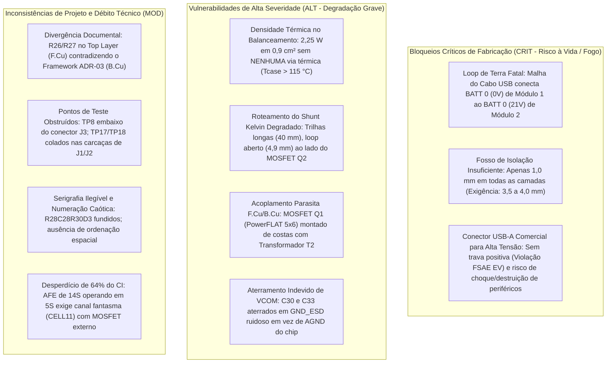

# Relatório de Avaliação Crítica de Hardware — BMS 5S V2 (L99BM114)
**Arquitetura Modular 20s18p — Formula SAE Electric**
**Data de Emissão:** 19 de Outubro de 2026  
**Status do Projeto:** 🛑 **REPROVADO PARA FABRICAÇÃO (BLOQUEIOS CRÍTICOS DETECTADOS)**  
**Nível de Prontidão Tecnológica Real (TRL):** **TRL 3 (Modelagem Circuital e Conceitual)**

---

## 1. Sumário Executivo & Veredito de Engenharia

Este documento consolida a revisão técnica profunda, minuciosa e desprovida de complacência realizada no hardware do módulo **BMS 5S V2**, confrontando o esquemático hierárquico, o layout físico de 4 camadas (`BMS_5S_v2.kicad_pcb`), as renderizações 3D (`top_render.png` e `bot_render.png`) e as diretrizes do `EVALUATION_FRAMEWORK.md`.

Apesar de a ferramenta de CAD acusar **0 erros de DRC e 0 erros de ERC**, a análise de integridade de sinal, isolação galvânica e segurança veicular identificou **falhas conceituais e físicas de nível CATASTRÓFICO (CRIT)**. A energização e interconexão de módulos neste estado causaria a **destruição imediata por curto-circuito de alta corrente entre módulos empilhados**, além da **violação direta de regras mandatórias do regulamento Formula SAE EV (FSAE EV Rules)** e da norma internacional de isolamento **IEC 60664-1**.

---

## 2. Diagrama de Classificação de Riscos e Bloqueios

---

## 3. Análise Crítica Detalhada pelos 4 Pilares de Engenharia

### Pilar 1: Precisão Metrológica, Sensoriamento e Balanceamento

#### 1.1. Inconsistência Documental Crítica (ADR-03 vs. Layout Real)
* **Declaração no Framework (`EVALUATION_FRAMEWORK.md`, ADR-03, L174):**
  > *"Alocação dos resistores 2512 no lado inferior (B.Cu), liberando espaço na face superior para filtros sensíveis e rotas Kelvin."*
* **Constatação no Hardware Real (`BMS_5S_v2.kicad_pcb` e `top_render.png`):**
  Os resistores anti-surto `R26` e `R27` (100 $\Omega$, 1 W, encapsulamento 2512) estão soldados no **`F.Cu` (Face Superior)** nas coordenadas `(122.20, 97.30)` e `(127.20, 97.30)`, logo à esquerda do CI `IC1`.
* **Impacto:** Evidencia descompasso entre a documentação de defesa técnica e a implementação física.

#### 1.2. Violação de Boas Práticas Kelvin no Sensoriamento de Corrente (Shunt)
* As trilhas `ISENSEP_conn` e `ISENSEM_conn` partem do conector `J3` ($Y = 137,7\text{ mm}$) e percorrem cerca de **40 mm na camada `B.Cu`** até os resistores `R26/R27`:
  * A distância entre as trilhas é de **$4,9\text{ mm}$** ($X = 122,3\text{ mm}$ vs. $X = 127,2\text{ mm}$), criando uma **área de espira diferencial inaceitável**.
  * A trilha `ISENSEP_conn` passa a menos de $0,7\text{ mm}$ do dreno do MOSFET de potência `Q2` (`STD105N10F7AG`, TO-252), que conduz a corrente de comutação total do retorno do pack.
* **Cálculo de Ruído:** Em um resistor shunt de $100\ \mu\Omega$, $1\text{ A}$ produz um sinal diferencial de apenas $100\ \mu\text{V}$. O transitório de comutação do inversor de tração ($dI/dt > 100\text{ A/}\mu\text{s}$) induzirá milivolts de ruído espúrio pela Lei de Faraday ($\mathcal{E} = -d\Phi/dt$), falseando o estado de carga (SoC) e violando a meta de resolução $\le 50\text{ mA}$.

#### 1.3. Densidade Térmica Excessiva no Balanceamento Passivo
* Os 6 resistores de sangria (`R6, R10, R13, R17, R9, R14`, $39\ \Omega$, tamanho 2010) estão agrupados em fileira na camada inferior (`B.Cu`) com espaçamento entre corpos de **apenas $1,0\text{ mm}$** ($X = 135,9\text{ a }154,2\text{ mm}$).
  * **Potência de Sangria:** $P = 5 \times \frac{(4,2\text{ V})^2}{39\ \Omega} \approx 2,26\text{ W}$ concentrados em uma área de meros $0,9\text{ cm}^2$.
  * **Ausência de Vias Térmicas:** A inspeção do arquivo de PCB revelou **ZERO vias térmicas** (*thermal stitching vias*) sob ou no entorno desses resistores. Existem apenas 6 vias de sinal exclusivas de cada nó de balanceamento.
  * **Deriva Térmica:** FR4 conduz mal o calor ($\sim 0,3\text{ W/(m}\cdot\text{K)}$). A temperatura de carcaça ultrapassará **$115\text{ °C}$** em regime contínuo, aquecendo por condução direta os capacitores cerâmicos do AFE (`C12..C20`) localizados exatamente no verso da placa (`F.Cu`), gerando descalibração na leitura de tensão no topo de carga.

#### 1.4. Ineficiência Arquitetural: 64% do CI Ocioso
* Utilizar o chip de 14S (`L99BM114`) para gerenciar um módulo de 5S forçou:
  * Curto-circuitar 19 pinos do CI na rede dummy `NC2`;
  * Manter uma célula ímpar fantasma (`CELL11`) equipada com MOSFET externo `Q11`, resistores e capacitor diferencial `C42` para satisfazer o comparador de diagnóstico interno.
  * Custo de silício e área de placa excessivos quando comparados a circuitos dedicados de 6S/8S.

---

### Pilar 2: Integridade de Sinal, Isolação Galvânica e Segurança Elétrica

#### 2.1. O Erro Fatal: Curto-Circuito entre Módulos Adjacentes pela Blindagem
Este é o achado mais grave de todo o projeto:
1. Em `Support_and_Debug.kicad_sch`, o pino 6 de `J3` (`BATT 0`, polo negativo do módulo) está soldado na rede **`GND_ESD`**.
2. Em `Power_Management.kicad_sch`, o dreno de `Q2` (MOSFET de polaridade reversa) une `AGND` diretamente a **`GND_ESD`**.
3. Em `Isolated_Communication.kicad_sch`, as carcaças metálicas (`Pad SH`) dos conectores `J1` e `J2` estão aterradas na rede **`GND_ESD`**.

> [!CAUTION]
> **Mecanismo da Falha Catastrófica (Fogo no Acumulador):**
> * No **Módulo 1** (células 1 a 5, 0 a 21 V), a carcaça de `J2` está no potencial de **$0\text{ V}$**.
> * No **Módulo 2** (células 6 a 10, 21 a 42 V), o polo `BATT 0` está conectado eletricamente ao topo do Módulo 1 ($+21\text{ V}$). Logo, a carcaça de `J1` do Módulo 2 está no potencial de **$+21\text{ V}$**!
> * Ao interconectar os dois módulos usando um cabo USB padrão blindado, **a malha metálica do cabo curto-circuitará diretamente $0\text{ V}$ com $+21\text{ V}$**!
> * **Consequência:** Curto-circuito pleno das 5 células do Módulo 1 através da malha fina do cabo de comunicação. Correntes de centenas de ampères vaporizarão o cabo, queimarão trilhas da PCB e criarão risco imediato de arco voltaico e fuga térmica (*thermal runaway*).

#### 2.2. Violação de Normas de Creepage e Clearance (Apenas 1,0 mm)
* **Exigência Normativa (IEC 60664-1 Grau de Poluição 2 / FSAE EV):** *Clearance* $\ge 3,5\text{ mm}$ e *Creepage* $\ge 4,0\text{ mm}$.
* **Realidade no Layout:**
  * O plano de terra da zona de comunicação termina em $Y = 79,5\text{ mm}$.
  * O plano de terra do circuito de medição começa em $Y = 80,5\text{ mm}$.
  * **A separação entre os planos de cobre é de míseros $1,0\text{ mm}$ em todas as 4 camadas (`F.Cu`, `In1.Cu`, `In2.Cu`, `B.Cu`)!**
  * Sob os transformadores `T1` e `T2`, os planos internos de cobre chegam até a borda de 1,0 mm. Não há abertura de ranhura fresada (*slot* de ar) na placa.
  * Sob transientes rápidos de modo comum ($dV/dt$), a capacitância parasita entre essas ilhas tão próximas acoplará ruído diretamente no chip de sensoriamento.

#### 2.3. Trilhas de Cobre Cortando a Fronteira de Isolação
Foram detectadas **10 trilhas de cobre atravessando diretamente a fenda de 1,0 mm**:
* Trilha `BATT_PLUS` cruzando no `F.Cu` de $Y = 74,2\text{ mm}$ para $Y = 103,6\text{ mm}$;
* Trilhas `/Isolated Communication/FAULTH` e `FAULTL` cruzando no `F.Cu`;
* Trilha `/Isolated Communication/BATT_DOWN` cruzando no `F.Cu`;
* Trilhas de `GND_ESD` cruzando no `B.Cu` em múltiplas posições ($X = 121,2\text{ mm}$, $X = 165,65\text{ mm}$);
* Trilha de `AGND` cruzando no `F.Cu` em $(142,55; 77,15) \to (142,55; 81,55)$.

A placa **não possui segregação física galvânica real**, sendo sumariamente reprovada no escrutínio técnico da Formula SAE.

---

### Pilar 3: Arquitetura de Potência e Robustez Eletromagnética

#### 3.1. Sobreposição Parasita F.Cu / B.Cu entre Q1 e T2
* Na camada superior (`F.Cu`), o MOSFET de comutação `Q1` (`STL8N10LF3`, PowerFLAT 5x6) e o capacitor de alta tensão `C5` estão posicionados em $X = 150,5\text{ mm},\ Y = 78,7\text{ mm}$.
* Na camada inferior (`B.Cu`), o transformador de pulso isolado `T2` (`HMU2103NL`) está em $X = 154,5\text{ mm},\ Y = 76,4\text{ mm}$.
* Eles estão **montados diretamente sobrepostos através de apenas 1,6 mm de fibra de vidro**. Os pulsos de chaveamento de `Q1` (`EXTDRV` / `VREG`) irradiam campo eletromagnético diretamente para dentro das bobinas do canal isolado `ISOH`, induzindo erros cíclicos de paridade no barramento *daisy-chain*.

#### 3.2. Aterramento Incorreto dos Pinos VCOM
* Os capacitores de estabilização do modo comum `C30` e `C33` ($1\ \mu\text{F}$) foram aterrados na rede externa `GND_ESD`.
* Conforme o datasheet do L99BM114 (Fig. 67), o desacoplamento de `VCOM` deve retornar ao **terra analógico limpo do chip (`AGND`)**. O roteamento para o terra sujo injeta espúrios no ponto central dos enrolamentos do transformador.

---

### Pilar 4: DFM, DFA, DFT e Conformidade Regulatória (Formula SAE EV)

#### 4.1. Conectores USB Tipo A: Inaceitáveis para Aplicação Veicular de Tração
1. **Regulamento FSAE EV (Regra EV4.x - Mecanismos de Travamento):** Todo conector elétrico no trem de força e nos circuitos de segurança deve possuir **trava mecânica positiva (*positive locking*)**. Conectores USB comerciais funcionam por atrito. Sob vibrações veiculares de $10\text{ a }20\text{ G}$, o conector desconectará em pista.
2. **Risco Crítico de Fator Humano (Poka-Yoke):** O pino 1 de `J2` conduz `BATT_PLUS` (até 21 V). Se um membro da equipe acidentalmente plugar um celular, pen drive ou notebook nessa porta, o periférico será **destruído instantaneamente**.
3. **Isolamento de Tensão:** Conectores USB comerciais são homologados para apenas **$30\text{ V}_{\text{DC}}$**, operando fora de especificação em módulos em série.

#### 4.2. Inacessibilidade Física de Pontos de Teste (DFT)
* **`TP8`**: Foi posicionado **diretamente embaixo do corpo do conector `J3`** (`Molex Micro-Fit 16-pin`). Uma vez soldado o conector, o pad de teste fica fisicamente bloqueado.
* **`TP17` e `TP18`**: Prensados entre as carcaças metálicas aterradas de `J1` e `J2`. É impossível conectar uma garra de osciloscópio sem provocar curto-circuito com a carcaça.

#### 4.3. Falhas Graves de Serigrafia (DFA)
* No `F.SilkS`, os textos de múltiplos componentes adjacentes colapsaram em strings ilegíveis: `R28C28R30D3` e `R29R32`.
* No `B.SilkS`, as designações dos filtros de terminação formam blocos impenetráveis: `C46R54R53C48C47` e `C43R52R51C45C44`.
* A numeração dos componentes não possui coerência espacial, impossibilitando montagem ágil ou inspeção visual.

---

## 4. Tabela de Auditoria dos Gaps (Framework vs. Realidade)

| ID | Item Avaliado | Status Declarado | Diagnóstico Real no Hardware | Severidade Real |
| :---: | :--- | :---: | :--- | :---: |
| **G-01** | Topologia 5S no AFE 14S | Resolvido na V2 | Resolvido no circuito, mas acarretou desperdício de 64% do CI e inclusão de componentes fantasma. | **MOD** |
| **G-02** | Roteamento Kelvin do Shunt | Resolvido na V2 | **FALHA GRAVE**: Trilhas longas (40 mm), loop aberto (4,9 mm), adjacentes ao MOSFET de chaveamento `Q2`. | **ALT** |
| **G-03** | Isolação Galvânica T1/T2 | Resolvido na V2 | **FALHA CATASTRÓFICA**: Aterramento dos shields de J1/J2 em `GND_ESD` causa curto-circuito mortal entre módulos em série. | **CRIT** |
| **G-04** | Resistores de Shunt em 2512 | Resolvido na V2 | Componentes atualizados para 2512, porém montados na face superior (`F.Cu`), contradizendo o ADR-03. | **MOD** |
| **G-05** | Terminação Split / Filtro CM | Resolvido na V2 | Circuito adicionado, mas com capacitores `VCOM` ligados ao terra incorreto (`GND_ESD`). | **ALT** |
| **G-06** | Barreira de Creepage / Clearance | $\ge 3,5\text{ mm} / 4,0\text{ mm}$ | **VIOLAÇÃO DE NORMA**: Fosso de apenas 1,0 mm sem ranhura mecânica; 10 trilhas cruzam a fronteira. | **CRIT** |
| **G-07** | Conectores Daisy-Chain | Conectores de Borda | Conectores USB-A comerciais sem trava positiva, violando normas de segurança da Formula SAE EV. | **CRIT** |
| **G-08** | Dissipação Térmica no Balanceamento | Mapeado para layout | **FALHA TÉRMICA**: 2,25 W concentrados em 0,9 cm² com zero vias térmicas; risco de queima e deriva de leitura. | **ALT** |

---

## 5. Roteiro Obrigatório de Modificações (Bloqueios de Engenharia V2.1)

Para que a placa possa ser enviada para manufatura com segurança, as seguintes intervenções no esquemático e no layout são mandatórias:

1. **Eliminar o Curto-Circuito de Terras (CRIT):**
   * Desconectar os pads de carcaça (`Pad SH`) de `J1` e `J2` da rede `GND_ESD`.
   * Manter as carcaças de comunicação isoladas ou aterradas exclusivamente de forma capacitiva de alta tensão ($1\text{ nF} / 2\text{ kV}$ em paralelo com $1\text{ M}\Omega$ para chassi verdadeiro).
   * Reconectar os capacitores `C30` e `C33` (`VCOM`) diretamente ao `AGND` limpo do L99BM114.

2. **Abrir a Barreira de Isolação Real (CRIT):**
   * Retirar todos os planos de cobre (`F.Cu`, `In1.Cu`, `In2.Cu`, `B.Cu`) sob os transformadores `T1` e `T2`, garantindo **no mínimo $4,0\text{ mm}$ livres** entre a zona dos conectores e a zona de sensoriamento.
   * Inserir um rasgo mecânico de fresagem (*isolation slot*) de $1,5\text{ mm}$ na camada `Edge.Cuts` sob o vão dos transformadores.
   * Eliminar todas as 10 trilhas de cobre que cortam o fosso de isolamento sem acoplamento magnético/óptico.

3. **Substituir Conectores USB-A por Padrão Automotivo com Trava (CRIT):**
   * Substituir `J1` e `J2` por conectores industriais com trava mecânica positiva obrigatória (ex.: **Molex Micro-Lock Plus**, **JST PA** ou **Harwin Datamate**).

4. **Refazer o Roteamento do Shunt em Par Diferencial Estrito (ALT):**
   * Roteamento coplanar acoplado para `ISENSEP` e `ISENSEM` ($w = 0,25\text{ mm}$, $s = 0,20\text{ mm}$), blindado por plano `AGND` contínuo e afastado de `Q2`.

5. **Implementar Alívio Térmico no Balanceamento (ALT):**
   * Espaçar os resistores `R6, R10, R13, R17, R9, R14` em pelo menos $2,5\text{ mm}$ entre corpos.
   * Adicionar malha de vias térmicas passantes (drill de $0,3\text{ mm}$, passo de $1,2\text{ mm}$) transferindo o calor para as camadas internas.

6. **Desobstruir TestPoints e Corrigir Serigrafia (MOD):**
   * Mover `TP8` para fora do footprint de `J3`;
   * Afastar `TP17/TP18` das carcaças de comunicação;
   * Reorganizar e espaçar todos os textos da serigrafia no `F.SilkS` e `B.SilkS`.
