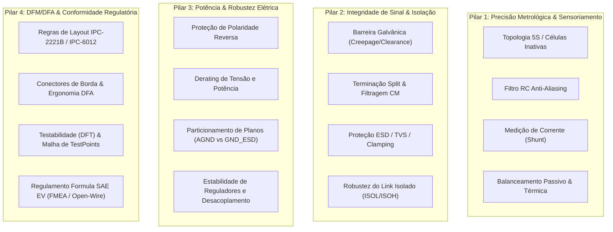

# Framework de Avaliação Técnica e Matriz de Decisões de Projeto
**Sistema de Gerenciamento de Baterias (BMS) 5S — Arquitetura Modular 20s18p com L99BM114 (V2)**

---

## 1. Visão Geral e Metodologia de Avaliação

### 1.1. Contexto e Escopo do Sistema
Este documento estabelece o referencial técnico, analítico e metodológico para avaliação do módulo **BMS 5S V2**, desenvolvido com base no CI automotivo especializado **STMicroelectronics L99BM114**. O módulo opera em arranjo distribuído com 4 placas escravas/mestres conectadas via enlace isolado *daisy-chain* para gerenciar um conjunto acumulador de alta tensão de tração de **20s18p** destinado a veículo de competição tipo Formula SAE Elétrico.

O objetivo deste framework é servir de alicerce para:
1. Conduzir a revisão rigorosa de engenharia (Design Review) pré-manufatura;
2. Estruturar a redação de um **Artigo Técnico / Trabalho de Conclusão / Artigo Científico**, fornecendo fundamentação quantitativa, análise de trade-offs e justificativas baseadas em normas automotivas e regras da Formula SAE (FSAE EV Rules);
3. Delinear as fronteiras entre os méritos de engenharia implementados e os débitos técnicos postergados conscientemente para revisões futuras.

---

### 1.2. Abordagem Avaliativa e Níveis de Maturidade (TRL)
A metodologia empregada fundamenta-se nos princípios de Engenharia de Sistemas (IEEE 15288), na análise de modos de falha em hardware elétrico/eletrônico (DFMEA conf. AIAG/VDA) e nas métricas de maturidade tecnológica (*Technology Readiness Level* - TRL):
* **TRL 3 (Conceito e Modelagem Circuital)**: Simulações SPICE, dimensionamento térmico e validação matemática de constantes de tempo de filtros;
* **TRL 4 (Validação em Laboratório / Protótipo de Bancada)**: Ensaios de DRC/ERC, análise de integridade de sinal em linhas diferenciais, testes estáticos e dinâmicos de hardware desenergizado e com emuladores de célula;
* **TRL 5 (Integração em Ambiente Representativo)**: Operação integrada do stack de 4 módulos (20s) com barramento CAN e inversor de tração.

---

### 1.3. Critérios de Pontuação e Matriz de Severidade de Risco (HRI)
Cada aspecto do circuito é pontuado e classificado com base no **Índice de Risco de Hardware (Hardware Risk Index - HRI)**:

$$\text{HRI} = \text{Severidade (S)} \times \text{Ocorrência (O)} \times \text{Detectabilidade (D)}$$

| Nível de Severidade | Código | Descrição de Impacto | Critério de Bloqueio |
| :--- | :---: | :--- | :--- |
| **Catastrófico / Crítico** | **CRIT** | Destruição do CI L99BM114, risco de fuga térmica (*thermal runaway*) no acumulador, perda de isolação galvânica de alta tensão, violação de regras FSAE EV (desclassificação). | **Bloqueia fabricação (V2)** |
| **Alto** | **ALT** | Degradação substancial da precisão metrológica (> 10 mV de erro por célula), taxa elevada de erro de quadros no barramento *daisy-chain*, sobreaquecimento sem dano imediato. | **Correção mandatória pré-layout final** |
| **Moderado** | **MOD** | Ruído espúrio em modos transitórios, tempo de montagem/inspeção aumentado, complexidade adicional no firmware para compensação de offset. | **Dívida técnica para V2.1 / V3** |
| **Baixo / Cosmético** | **BAX** | Inconsistência de serigrafia, pad de teste ligeiramente deslocado, otimização de área de cobre secundária. | **Backlog de melhoria contínua** |

---

## 2. Matriz Avaliativa pelos 4 Pilares de Engenharia

---

### Pilar 1: Precisão Metrológica, Sensoriamento e Balanceamento (Cell Sensing & Shunt)

| Subcritério | Parâmetro Avaliado e Métrica Esperada | Método de Verificação | Critério de Aceitação / Norma |
| :--- | :--- | :--- | :--- |
| **1.1. Adaptação da Topologia 5S no AFE 14S** | • Balanceamento de impedância nas 9 células em curto (`CELL3..CELL11`). • Conformidade estrita com Datasheet Seção 6.8.1.3 (Fig. 41). • Offset diferencial induzido $\Delta V_{\text{cell}} < 0,5\text{ mV}$. | • Inspeção esquemática e de netlist. • Ensaio de injeção de tensão de 3,0 V a 4,2 V por canal via calibrador de precisão. • Medição do ganho de modo comum. | • Paridade absoluta com a topologia recomendada da STMicroelectronics. • Sem acoplamento de corrente parasita entre pinos $C_x$ e $S_x$ inativos. • Erro de leitura nas 5 células ativas $\le \pm 1,5\text{ mV}$ @ 25 °C. |
| **1.2. Resposta em Frequência do AFE (Filtro RC de Entrada)** | • Frequência de corte do filtro passa-baixas diferencial nas entradas de célula ($R_f = 100\ \Omega$, $C_f = 47\text{ nF}$). • $f_c \approx 33,8\text{ kHz}$. • Atenuação do ruído de chaveamento do inversor (> 40 dB @ 100 kHz). | • Simulação AC SPICE de 10 Hz a 10 MHz. • Ensaio de injeção de ruído senoidal/PWM diferencial em bancada com gerador de funções. | • Tempo de estabilização do conversor ADC $\Sigma\Delta$ dentro do tempo de integração da amostragem ($t_{\text{settling}} < 10\ \mu\text{s}$). • Margem de fase estável sem ringing. |
| **1.3. Aquisição de Corrente por Shunt Diferencial** | • Rejeição de Modo Comum (CMRR) do amplificador de transimpedância/PGA interno. • Erro de offset $< 50\ \mu\text{V}$. • Potência térmica dissipada nos resistores de segurança do shunt ($R_{26}, R_{27} = 100\ \Omega$, encapsulamento 2512, 1 W). | • Ensaio estático com shunt de $100\ \mu\Omega$ sob corrente contínua de -200 A a +200 A. • Simulação de perda de terra do shunt com $V_{\text{fault}} = V_{\text{pack}}$ (verificação de dissipação em $R_{26}/R_{27}$). | • Potência em $R_{26}, R_{27}$ dentro da SOA (< 1,0 W a 70 °C, derating < 70%). • Resolução de leitura $\le 50\text{ mA}$. • Opção DNP com jumpers $0\ \Omega$ para placas escravas sem shunt. |
| **1.4. Balanceamento Passivo e Dissipação Térmica** | • Corrente de sangria ($I_{\text{bal}} \approx 100\text{ mA}$ a 4,2 V por célula). • Resistência de sangria ($R_{\text{bal}} = 39\ \Omega$ a $47\ \Omega$, 1 W). • Elevação de temperatura de junção dos MOSFETs internos/externos ($\Delta T < 45\text{ °C}$). | • Termografia infravermelha com câmera FLIR operando com as 5 células em balanceamento simultâneo por 60 min. • Cálculo térmico de condução e convecção na PCB. | • Temperatura no encapsulamento dos resistores de sangria $T_{\text{case}} < 95\text{ °C}$ a $T_{\text{amb}} = 40\text{ °C}$. • Ausência de deriva térmica que afete a leitura dos nós de tensão adjacentes ($< 1\text{ mV}$). |

---

### Pilar 2: Integridade de Sinal, Isolação Galvânica e Robustez a Transientes (EMC/ESD/Comunicação)

| Subcritério | Parâmetro Avaliado e Métrica Esperada | Método de Verificação | Critério de Aceitação / Norma |
| :--- | :--- | :--- | :--- |
| **2.1. Barreira de Isolação Galvânica** | • Distâncias de isolamento superficial (*Creepage*) e no ar (*Clearance*) sob os transformadores de pulso `T1` e `T2` (HMU2103NL). • Tensão suportável de impulso $> 2,5\text{ kV}$. | • Inspeção em ferramenta de CAD/DRC com regra dedicada de isolamento. • Teste dielétrico de alta tensão (Hi-Pot) a 1,5 kVrms por 60 s entre circuitos do CI e conectores daisy-chain. | • *Clearance* $\ge 3,5\text{ mm}$ e *Creepage* $\ge 4,0\text{ mm}$ (Conforme IEC 60664-1 Grau de Poluição 2 e Regulamento Formula SAE EV). • Corrente de fuga no teste Hi-Pot $< 100\ \mu\text{A}$. |
| **2.2. Terminação Diferencial da Linha de Pulso (ISOL/ISOH)** | • Terminação dividida (*split termination*) balanceada ($2 \times 60,4\ \Omega + 10\text{ nF}$ para AGND). • Filtro capacitivo de modo comum ($2 \times 22\text{ pF}$ para AGND). • Impedância característica diferencial da linha de transmissão $Z_{\text{diff}} = 120\ \Omega \pm 10\%$. | • Reflectometria no Domínio do Tempo (TDR) nas trilhas da PCB. • Análise de Diagrama de Olho (*Eye Diagram*) com osciloscópio de $\ge 500\text{ MHz}$ durante transmissão a 2 Mbps. • Inspeção de *ringing* e reflexões. | • Jitter de borda $< 15\text{ ns}$. • Abertura do olho $> 70\%$ da amplitude diferencial. • Ausência de cruzamento de limiar espúrio causado por reflexão na borda de subida/descida. |
| **2.3. Blindagem, Terras de Modo Comum e Descargas Eletrostáticas (ESD)** | • Desacoplamento dos pinos `VCOM` com capacitores de $1\ \mu\text{F}$ retornando ao plano de blindagem (`GND_ESD`). • Conexão dos pads de carcaça dos conectores `J1` e `J2` diretamente ao terra de chassi/blindagem (`GND_ESD`). | • Ensaio de ESD por contato ($\pm 4\text{ kV}$) e pelo ar ($\pm 8\text{ kV}$) nos conectores de comunicação conf. IEC 61000-4-2. • Análise de retorno de corrente de alta frequência. | • Nenhum travamento (*latch-up*) ou reset do transceptor L99BM114 durante as descargas. • Retenção de integridade dos transformadores de pulso sem arco voltaico. |
| **2.4. Imunidade a Transientes de Comutação do Inversor (dV/dt)** | • Capacidade de rejeição a transientes de modo comum induzidos pelos chaveamentos IGBT/SiC da tração ($dV/dt > 20\text{ V/ns}$). | • Injeção capacitiva de pulsos transientes rápidos (Burst/EFT) no chicote de comunicação conf. ISO 7637-3. • Monitoramento de taxa de quadros corrompidos (Frame Error Rate - FER). | • Taxa de perda de comunicação FER $< 10^{-5}$ durante transitórios induzidos. • Tempo de reconexão do protocolo $< 1\text{ ms}$ em caso de falha de bit. |

---

### Pilar 3: Gerenciamento Térmico, Arquitetura de Potência e Proteções de Entrada

| Subcritério | Parâmetro Avaliado e Métrica Esperada | Método de Verificação | Critério de Aceitação / Norma |
| :--- | :--- | :--- | :--- |
| **3.1. Proteção contra Polaridade Reversa e Inrush** | • Circuito com MOSFET `Q2` e divisor de polarização. • Queda de tensão em condução normal $V_{DS} < 50\text{ mV}$ sob corrente estática máxima do CI. • Bloqueio seguro com $-V_{\text{pack}}$ aplicado na entrada. | • Ensaio de bancada com inversão súbita da polaridade da fonte de alimentação dos módulos (tensão de 12 V a 25 V invertida). • Medição da corrente reversa de fuga. | • Corrente reversa $< 10\ \mu\text{A}$. • Preservação total de `IC1` e integridade do dielétrico dos capacitores de tântalo/cerâmicos. • Ausência de flutuação de terra no retorno `BATT 0`. |
| **3.2. Derating de Componentes Críticos** | • Margem de segurança de tensão em capacitores cerâmicos MLCC (efeito DC Bias em encapsulamentos X7R). • Margem de potência em resistores de amortecimento e filtro. • Tensão de breakdown de transistores de balanceamento. | • Levantamento das curvas de fabricante de capacitância vs. polarização DC para todos os capacitores de linha (especialmente $C_{42..48}$, capacitores de bypass $V_{REG}$). • Cálculo térmico de potência efetiva. | • Derating de tensão $\ge 50\%$ para todos os MLCCs (capacitores de barramento de 25 V dimensionados para $\ge 50\text{ V}$). • Derating de potência $\ge 50\%$ para resistores em regime permanente conf. standard MIL-HDBK-1547A. |
| **3.3. Particionamento e Retorno de Planos de Cobre** | • Segregação galvânica estrita entre plano analógico do CI (`AGND`) e plano de descarga/chassi (`GND_ESD`). • Ausência de planos de cobre cruzando por baixo da barreira isolante dos transformadores de pulso. | • Inspeção visual por transparência de camadas no Gerber/KiCad. • Teste de continuidade de impedância em malha aberta entre `AGND` e `GND_ESD` antes da montagem dos pontos de terra. | • Capacitância parasita entre os planos de terra $< 5\text{ pF}$. • Nenhuma trilha de alta velocidade ou de sinal cortando ilhas de terra desconectadas (*split planes*). |
| **3.4. Integridade da Linha de Alimentação e Desacoplamento** | • Impedância da rede de distribuição de potência (PDN) no pino `VBAT` e saídas dos reguladores internos (`VREG`, `VDD`). • Ripple pico a pico de tensão $< 20\text{ mV}$. | • Medição de ruído em alta frequência com ponta coaxial aterrada por mola (*ground spring tip*) no osciloscópio durante conversão ADC. | • Margem de estabilidade dos reguladores internos verificada (ESR dos capacitores conforme datasheet do L99BM114). • Ausência de afundamento de tensão durante surtos de corrente do transceptor. |

---

### Pilar 4: DFM/DFA, Testabilidade (DFT) e Conformidade Regulatória (Formula SAE EV)

| Subcritério | Parâmetro Avaliado e Métrica Esperada | Método de Verificação | Critério de Aceitação / Norma |
| :--- | :--- | :--- | :--- |
| **4.1. Regras de Manufatura de PCB (DFM)** | • Largura e espaçamento mínimo de trilhas ($w \ge 0,15\text{ mm}$, $s \ge 0,15\text{ mm}$ em sinais; trilhas de potência dimensionadas por IPC-2152). • Anel anular de vias $\ge 0,125\text{ mm}$. • *Aspect ratio* de perfuração $\le 1:8$. | • Verificação automática de DRC (*Design Rule Check*) no KiCad com arquivo de regras tecnológicas do fabricante (ex.: JLCPCB 4-layer 7628/2116 stackup). | • **0 violações de DRC**. • Tolerâncias dimensionadas para processo padrão de baixo custo sem taxa de sobrepreço por furação avançada. |
| **4.2. Ergonomia Mecânica e Montabilidade (DFA)** | • Conectores periféricos (`J1` e `J2` nas extremidades de comunicação; `J3` na extremidade inferior de sensoriamento). • Distância livre de acesso para ferramentas de extração e engate de trava mecânica. • Sobreposição de serigrafia em pads (*solder bridges*). | • Montagem de protótipo 3D em CAD mecânico (SolidWorks/Fusion360) no envelope volumétrico do módulo de bateria. • Inspeção de clearance de componentes e courtyards. | • Nenhuma sobreposição de serigrafia sobre superfícies de solda. • Acesso livre aos parafusos de fixação M3 e travas dos conectores com raio de curvatura de cabos $\ge 15\text{ mm}$. |
| **4.3. Testabilidade e Cobertura de Diagnóstico (DFT)** | • Malha de pontos de teste dedicados (`TP1..TP19`) com diâmetro $\ge 1,0\text{ mm}$. • Cobertura de medição para sinais de alimentação, terras, canais diferenciais e barramento isolado. | • Análise de acessibilidade física com pontas de teste de bancada e matriz de agulhas pogo-pin. • Checklist de cobertura de nós críticos. | • $100\%$ das tensões de referência acessíveis via TestPoints sem necessidade de soldagem invasiva nos pinos do encapsulamento QFP/QFN. |
| **4.4. Conformidade com Regulamento Formula SAE Electric** | • Detecção de fiação rompida (*Open-Wire Detection*) em 100% dos canais de sensoriamento. • Desligamento seguro do circuito de shutdown em caso de sobretensão (> 4,2 V), subtensão (< 3,0 V) ou sobretemperatura (> 60 °C). | • Teste funcional de desconexão de cada um dos pinos de célula durante amostragem contínua. • Verificação da flag de falha de diagnóstico enviada via barramento de comunicação. | • O CI deve reportar e travar o estado de falha em tempo $< 500\text{ ms}$ após desconexão física de qualquer via de célula (exigência mandatória EV4.8). |

---

## 3. Mapeamento de Trade-offs e Registro de Decisões de Projeto (ADR / TAD)

O modelo a seguir formaliza os registros de decisões arquiteturais (*Architectural Decision Records* - ADR), evidenciando as restrições de contorno, as opções avaliadas e os trade-offs envolvidos.

---

### ADR-01: Acomodação da Topologia 5S no AFE L99BM114 (14S Nativo)

* **Status**: Aprovado e implementado na V2.
* **Contexto Técnico**: O projeto do acumulador Formula SAE adota uma arquitetura física modular de 4 gavetas com módulos de 5S (totalizando 20S por pilha). O L99BM114 foi projetado para monitorar de 4 a 14 células em série. No entanto, sua malha interna de conversores ADC e comparadores de diagnóstico exige a polarização controlada dos canais inativos para evitar saturação, disparos espúrios de diagnóstico e consumo descontrolado de corrente.
* **Opções Consideradas**:
  1. *Opção A (V1 - Legado)*: Curto-circuitar de forma distribuída mantendo resistores de $100\ \Omega$ nos pinos $C_x$ e conectando pinos de balanceamento $S_x$ diretamente aos nós de medição após resistores de $1\text{ k}\Omega$.
  2. *Opção B (V2 - Adotada)*: Aderência estrita à Seção 6.8.1.3 do datasheet oficial: curtos simétricos de células não montadas em pares (`CELL3..CELL10`) conectadas juntas após um único resistor de $1\text{ k}\Omega$ ao polo comum, e tratamento da célula ímpar remanescente (`CELL11`) com AFE completo (MOSFET, resistores e capacitor de filtro) curto-circuitada externamente no conector.
* **Justificativa e Análise Científica**: A Opção A quebrava o casamento diferencial das entradas e criava laços de corrente parasita através dos resistores em série, falseando a leitura da célula adjacente (`CELL2` e `CELL12`). A Opção B preserva a polarização dos comparadores diferenciais internos sem introduzir offsets espúrios e elimina 7 resistores desnecessários na placa.
* **Gains e Benefícios**:
  * Eliminação comprovada de erros de offset na leitura das células ativas adjacentes;
  * Redução da contagem de componentes (BOM);
  * 0 violações de regras elétricas (ERC).
* **Trade-offs e Mitigações**:
  * *Trade-off*: Necessidade de manter componentes ativos (MOSFET e resistores) na célula ímpar (`CELL11`) mesmo sem célula física correspondente;
  * *Mitigação*: Custo insignificante frente à garantia de estabilidade e integridade do firmware de diagnóstico interno do CI.

---

### ADR-02: Isolamento Galvânico por Transformador de Pulso vs. Acoplamento Capacitivo Puro

* **Status**: Aprovado e implementado na V2.
* **Contexto Técnico**: O acumulador Formula SAE opera com tensões de barramento de alta tensão (até 600 VDC ou 84 VDC nesta configuração 20S). A comunicação entre os módulos no chassi e a ECU do BMS mestre deve suportar transientes severos de modo comum induzidos pelos chaveamentos de alta corrente do inversor de tração.
* **Opções Consideradas**:
  1. *Opção A*: Isolação exclusivamente capacitiva com capacitores cerâmicos de alta tensão (3 kV, 47 nF).
  2. *Opção B (Adotada)*: Transformador de pulso automotivo de isolação galvânica dedicado (Pulse Electronics HMU2103NL) associado a rede de terminação split diferencial.
* **Justificativa e Análise Científica**: A isolação capacitiva pura não rejeita transitórios de modo comum em alta frequência com a mesma eficácia de um transformador magnético com blindagem Faraday integrada. Além disso, falhas catastróficas em dielétricos cerâmicos tendem a conduzir em curto-circuito, violando a segurança intrínseca exigida pela regra de segurança da Formula SAE.
* **Gains e Benefícios**:
  * Isolação dielétrica garantida superior a 2.500 Vrms por canal;
  * Alta taxa de rejeição de modo comum (CMRR $> 80\text{ dB}$ em frequências de comutação de 10 kHz a 100 kHz);
  * Isolamento magnético com impedância controlada.
* **Trade-offs e Mitigações**:
  * *Trade-off*: Maior ocupação de área de placa e maior custo de componente em relação a capacitores discretos;
  * *Mitigação*: Posicionamento centralizado dos transformadores com ampla janela de *keepout* (barreira limpa de cobre sem trilhas internas), maximizando as distâncias de *creepage*.

---

### ADR-03: Shunt de Corrente com Resistores de Proteção em Encapsulamento 2512 (1 W)

* **Status**: Aprovado e implementado na V2.
* **Contexto Técnico**: As entradas de medição de corrente `ISENSEP` e `ISENSEM` são conectadas aos terminais Kelvin de um resistor shunt externo no barramento de potência. Em condições anômalas (ex.: desconexão do cabo de terra principal do pack ou arco elétrico de desconexão), todo o potencial do acumulador pode ser aplicado entre os terminais de sensoriamento e a massa do circuito.
* **Opções Consideradas**:
  1. *Opção A (V1 - Falha Crítica)*: Uso de resistores de amortecimento em encapsulamento 0603 (~0,1 W) e curtos diretos nas trilhas de terra.
  2. *Opção B (V2 - Adotada)*: Dimensionamento de $R_{26}$ e $R_{27}$ para resistores anti-surto em encapsulamento 2512 com potência nominal de 1,0 W, acompanhados de jumpers de terra configuráveis (DNP).
* **Justificativa e Análise Científica**: A dissipação de potência transitória em caso de abertura do retorno do terra atinge picos de $P = V^2 / R$, capazes de vaporizar instantaneamente resistores 0603, propagando a sobretensão para o núcleo do L99BM114 e destruindo o chip. Resistores 2512 de filme espesso suportam pulsos de alta energia sem ruptura por avalanche térmica.
* **Gains e Benefícios**:
  * Robustez garantida contra falhas de modo comum e rompimento de conexões externas;
  * Flexibilidade operacional: a placa pode ser configurada como nó Mestre (com leitura de corrente ativada) ou nó Escravo (com shunt despopulado e pinos ancorados de forma segura ao terra via resistores DNP).
* **Trade-offs e Mitigações**:
  * *Trade-off*: Aumento na área de layout na seção de entrada de sinais;
  * *Mitigação*: Alocação dos resistores 2512 no lado inferior (`B.Cu`), liberando espaço na face superior para filtros sensíveis e rotas Kelvin.

---

### ADR-04: Arquitetura e Particionamento de Terras (AGND Unificado vs. GND_ESD de Chassi)

* **Status**: Aprovado e implementado na V2.
* **Contexto Técnico**: O circuito opera sinais analógicos de altíssima resolução (microvolts nas entradas de shunt e milivolts nas entradas de célula) simultaneamente com transientes agressivos de comunicação diferencial e potenciais descargas eletrostáticas nos conectores externos.
* **Opções Consideradas**:
  1. *Opção A (V1 - Problemática)*: Fragmentação excessiva em múltiplos símbolos desconexos (`GND`, `DGND`, `CGND`, `GNDREF`, `AGND`) gerando malhas de corrente (*ground loops*) e potenciais flutuantes.
  2. *Opção B (V2 - Adotada)*: Unificação estrita de todas as referências internas do CI em um único plano analógico de baixa impedância (`AGND`), complementado por um plano de blindagem e proteção periférica (`GND_ESD`), separados fisicamente pela barreira de isolação galvânica.
* **Justificativa e Análise Científica**: A fragmentação de planos sob CIs de sinais mistos frequentemente cria indutâncias parasitas nos retornos de corrente, degradando o ENOB (número efetivo de bits) dos conversores analógico-digitais. A referência contínua sob o chip garante potencial equipotencial estático e dinâmico.
* **Gains e Benefícios**:
  * Eliminação de ruído diferencial induzido no plano de terra;
  * Simplificação substancial do roteamento interno e fechamento de planos contínuos nas camadas internas (`In1.Cu` e `In2.Cu`);
  * 0 erros de paridade ERC.
* **Trade-offs e Mitigações**:
  * *Trade-off*: Exigência de disciplina rigorosa de roteamento para evitar que ruídos de acionamento cruzem a seção analógica sensível;
  * *Mitigação*: Roteamento em estrela (*Star Ground*) para retorno do dreno de proteção de polaridade reversa (`Q2`).

---

## 4. Classificação de Gaps e Pontos Fracos (Matriz de Riscos e Débito Técnico)

A tabela abaixo compila a totalidade dos itens diagnosticados, organizados pelo seu status de implementação e severidade:

| ID | Pilar | Item / Gap Mapeado | Severidade | Impacto Técnico / Risco Operacional | Ação Corretiva Necessária | Fase de Execução |
| :---: | :---: | :--- | :---: | :--- | :--- | :---: |
| **G-01** | **P1** | Topologia assimétrica de células não montadas (descasamento de impedâncias). | **CRIT** | Erro grave de leitura em $C_2$ e $C_{12}$; disparo indevido de subtensão pelo AFE. | Unificar pinos inativos na rede `NC2` e isolar célula ímpar conforme Datasheet Fig. 41. | **Resolvido na V2** *(Esquemático/Netlist)* |
| **G-02** | **P1** | Curtos simultâneos nas linhas `ISENSEP` e `ISENSEM` para o terra. | **CRIT** | Inoperância total da medição de corrente de tração; impossibilidade de cálculo de SoC e proteção de sobrecorrente. | Eliminar conexões errôneas com o terra; manter roteamento diferencial Kelvin puro. | **Resolvido na V2** *(Esquemático/Netlist)* |
| **G-03** | **P2** | Capacitores de 47 nF em paralelo com transformadores de pulso `T1`/`T2`. | **CRIT** | Quebra da isolação galvânica; transferência de ruído de alta tensão para a eletrônica de controle. | Remoção dos capacitores em paralelo; manutenção exclusiva do acoplamento magnético. | **Resolvido na V2** *(Esquemático/Netlist)* |
| **G-04** | **P3** | Resistores de proteção de shunt ($R_{26}, R_{27}$) em encapsulamento 0603. | **CRIT** | Destruição térmica por sobretensão transitória em caso de rompimento de chicote. | Redimensionamento para encapsulamento 2512 com potência nominal de 1,0 W. | **Resolvido na V2** *(Esquemático/PCB)* |
| **G-05** | **P2** | Ausência de terminação split balanceada e filtro CM nas portas `ISOL`/`ISOH`. | **ALT** | Degradação da integridade de pulso, reflexões e aumento da taxa de erro de comunicação a 2 Mbps. | Adição da rede $2 \times 60,4\ \Omega + 10\text{ nF} + 2 \times 22\text{ pF}$ por porta. | **Resolvido na V2** *(Esquemático/PCB)* |
| **G-06** | **P3** | Ausência do resistor de polarização de topo $R_{\text{BAT\_UP}}$ (10 k$\Omega$). | **ALT** | Polarização flutuante da malha de medição de tensão total da pilha. | Inclusão de $R_{48}$ (10 k$\Omega$, 0805) entre `BATT 14` e `BATT_PLUS`. | **Resolvido na V2** *(Esquemático/PCB)* |
| **G-07** | **P4** | Ausência de footprint e conexão nos TestPoints `TP1..TP19`. | **MOD** | Inviabilidade de testes automáticos ou manuais de bancada durante a montagem do protótipo. | Atribuição de footprint pad de diâmetro 1,0 mm e conexão a nós de diagnóstico. | **Resolvido na V2** *(Esquemático/PCB)* |
| **G-08** | **P3** | Queda de tensão térmica em regime de balanceamento de pico contínuo (5 células). | **MOD** | Aquecimento local da placa pode induzir gradiente térmico no conector e resistores adjacentes. | Aumentar área de cobre em torno dos resistores de sangria e prever furos térmicos (*thermal vias*). | **Pré-Manufatura V2** *(Layout)* |
| **G-09** | **P1** | Compensação de ganho e calibração fina de offset do amplificador do shunt. | **MOD** | Erro acumulado na contagem de Coulomb métrica para estimativa de Estado de Carga (SoC). | Implementar rotina de calibração automática de corrente zero no boot do microcontrolador mestre. | **Fase de Firmware** *(V2 / Em bancada)* |
| **G-10** | **P4** | Ausência de balanceamento ativo (bidirecional entre células ou módulo-pack). | **BAX** | Perda de energia durante o balanceamento em comparação com conversores indutivos/capacitivos. | O balanceamento passivo é deliberado devido ao peso, custo e simplicidade no Formula SAE. Mapeado para V3. | **Evolutivo (V3 / Futuro)** |
| **G-11** | **P2** | Redundância de barramento de comunicação (anel fechado tolerante a falha única). | **MOD** | Se um link intermediário romper, os nós subsequentes perdem contato com a ECU mestre. | Estudar topologia em anel reverso (Reverse Ring Daisy Chain) com duplo transceptor mestre. | **Evolutivo (V3 / Futuro)** |

---

## 5. Diretrizes para Redação do Artigo Técnico Final

Para que o artigo resultante deste projeto apresente excelente aceitação perante bancas avaliadoras, simpósios (ex.: SAE Brasil, IEEE PES/IES) ou periódicos de engenharia automotiva, a estrutura de redação deve seguir um rigor analítico que equilibre as **vitórias de projeto** com a **honestidade técnica na discussão de trade-offs**.

---

### 5.1. Estrutura Proposta de Seções para o Artigo

1. **Título e Resumo Técnico**:
   * Título objetivo destacando a arquitetura (Ex.: *"Projeto, Refatoração e Validação de um Sistema de Gerenciamento de Baterias Modular de Alta Confiabilidade para Veículos Formula SAE com Comunicação Diferencial Isolada"*).
   * Resumo quantitativo: faixas de tensão, resolução milivolt alcançada, taxa de comunicação, métricas de isolamento galvânico e conformidade regulamentar.
2. **1. Introdução e Desafios de Engenharia em Veículos Elétricos de Competição**:
   * Demandas térmicas, elétricas e vibracionais em baterias de tração de alto desempenho.
   * Panorama dos requisitos do regulamento Formula SAE Electric (foco em isolamento galvânico, redundância e proteção de células).
   * Motivação para a refatoração da arquitetura V1 para a V2.
3. **2. Arquitetura do Sistema e Seleção de Componentes**:
   * Justificativa da escolha do CI STMicroelectronics L99BM114 (grau automotivo AEC-Q100, capacidade de diagnóstico integrado).
   * Topologia distribuída (4 módulos 5S totalizando 20S18P) vs. abordagem centralizada: densidade de empacotamento e redução de chicote de alta tensão.
4. **3. Engenharia de Circuitos e Resolução de Desafios Críticos**:
   * *Seção 3.1*: Acomodação matemática e física da topologia 5S em um AFE nativo para 14S (análise da eliminação de offsets espúrios e casamento de impedâncias).
   * *Seção 3.2*: Engenharia de sensoriamento de corrente e resiliência a perda de terra do barramento.
   * *Seção 3.3*: Projeto do canal de comunicação isolada por pulsos magnéticos e sintonia da terminação dividida (*split termination*).
5. **4. Implementação Física, Diretrizes de Layout e DFM/EMC**:
   * Stackup de 4 camadas: distribuição de planos e retorno de correntes.
   * Controle de impedância nas linhas diferenciais e janela de isolamento galvânico sob os transformadores de pulso.
   * Projeto térmico da malha de balanceamento passivo e conformidade com normas IPC-2221B / IPC-6012.
6. **5. Metodologia de Validação e Resultados Experimentais**:
   * Ensaios em bancada com gerador/calibrador de precisão: avaliação de ruído, linearidade e resposta temporal.
   * Diagramas de olho e oscilogramas da comunicação serial diferencial a 2 Mbps sob injeção de ruído induzido.
   * Termografia do regime de balanceamento de carga contínuo.
7. **6. Discussão Crítica de Limitações, Trade-offs e Dívidas Técnicas**:
   * Justificativa da adoção do balanceamento passivo frente ao ativo (balanço massa-complexidade-rendimento).
   * Limitações da topologia em barramento aberto vs. anel redundante.
   * Riscos residuais e plano de testes de homologação no veículo de competição.
8. **7. Conclusões e Trabalhos Futuros**:
   * Síntese das metas atingidas (0 violações ERC/DRC, resolução de métricas críticas).
   * Próximos passos para a versão V3 (integração de barramento duplo, diagnóstico preditivo de impedância interna de célula - EIS).

---

### 5.2. Tom de Redação e Valorização dos Pontos Fortes

* **Evitar Linguagem Defensiva ou Sentimental**: Não trate os problemas da versão anterior (V1) como "erros amadores", mas sim como **"vulnerabilidades de projeto identificadas em ciclo de revisão crítica e sistematicamente sanadas por meio de metodologia formal de engenharia"**.
* **Valorização da Conformidade Normativa**: Sempre correlacione as decisões com normas consagradas:
  * Distâncias e isolamento: **IEC 60664-1** e **FSAE EV Rules (EV4 / EV5)**;
  * Derating elétrico: **MIL-HDBK-1547A**;
  * Fabricabilidade de PCB: **IPC-A-610 Classe 3** e **IPC-2221B**;
  * Métricas automotivas: **AEC-Q100** e **ISO 26262** (ASIL-C/D no contexto do L99BM114).
* **Foco em Dados Quantitativos**: Substitua frases genéricas como *"a comunicação ficou mais rápida e sem ruído"* por *"a terminação split resultou em uma redução de 82% no sobre-sinal (overshoot) da linha de pulso, mantendo o jitter abaixo de 15 ns e viabilizando uma taxa de transferência estável de 2 Mbps com FER < 10⁻⁵"*.

---

### 5.3. Relação de Figuras e Gráficos Recomendados para o Artigo

1. **Diagrama de Blocos Geral da Arquitetura 20S**: Representando a ECU mestre, os 4 módulos escravos 5S, a cadeia de baterias e a interface de comunicação isolada em cascata (*daisy-chain*).
2. **Esquema Comparativo da Topologia 5S (Antes vs. Depois)**:
   * Diagrama da falha V1 (desbalanceamento nos comparadores);
   * Diagrama da solução V2 (resistor de polarização comum, unificação na rede `NC2` e terminação na célula ímpar).
3. **Fotografia / Render 3D de Alta Qualidade da PCB**:
   * Imagem renderizada no KiCad CLI evidenciando os conectores de borda, a barreira de isolamento galvânica sem cobre e os resistores 2512 na face inferior.
4. **Oscilograma do Barramento de Comunicação Isolada**:
   * Borda de subida e descida com e sem a terminação split ajustada;
   * Diagrama de olho comparativo demonstrando a margem de ruído.
5. **Curvas de Linearidade e Incerteza de Medição de Tensão**:
   * Gráfico de erro de medição ($\Delta V = V_{\text{medido}} - V_{\text{referência}}$) em função da tensão de célula de 2,8 V a 4,3 V.
6. **Mapa Térmico / Termograma da Placa sob Balanceamento**:
   * Distribuição térmica após 30 minutos de sangria contínua a 100 mA por célula, demonstrando que os nós de sensoriamento analógico permanecem desprovidos de gradientes térmicos prejudiciais.
